# ANIMOL 맵별 제작 참고표

> 2026-11-10 정본 갱신: 아래 25개 맵 분석과 기존 LLM ZIP/JSON은 이전 배치의 참고 자료다. 현재 SW03/SW05 이름 이동·새 SW05 배치·ET-11까지의 현존 맵은 [최신 배치 보고서](ANIMOL_MAP_LAYOUT_REPORT.md), [별길 목장 최단 경로](STARWAY_SHORTEST_PATHS.md), [잔영 극장 최단 경로](ECHO_THEATER_SHORTEST_PATHS.md)를 우선한다. 가중치는 제작 제안이며 실제 입력 비용을 바꾸지 않는다.

현재 배치와 선택한 최단 경로의 행동을 함께 비교한다. 패턴 ID와 제안 가중치의 뜻은 [제작 가이드](ANIMOL_LLM_MAP_DESIGN_GUIDE.md)를 따른다. 전체 좌표·장치 설정·정답은 [참고 JSON](ANIMOL_LLM_MAP_REFERENCE.json), 입력별 상태 변화는 [재생 JSON](Validation/MapDesign/route_analysis.json)에 있다.

L은 게임 입력 비용, W0는 제안 계수로 계산한 기본 조작량 점수다. W0에는 사고 부담 수정치를 자동으로 붙이지 않았다. 정적 바닥 수는 장식 점유를 제외하며, 원래 배치 보고서의 지형 바닥 수는 장식 아래의 지형도 포함한다. 정적 영역과 막다른 길은 동적 통행 판정과 다르다.

| 원본 → 화면 | 최단 L | W0 | 이동 없는 유효 입력 | 패턴 |
|---|---:|---:|---:|---|
| [SW00](#sw00) → SW01 | 45 | 47.75 | 4 | P02, P03, P04, P06 |
| [SW01](#sw01) → SW02 | 54 | 55 | 2 | P02, P03, P05 |
| [SW02](#sw02) → SW03 | 77 | 87 | 20 | P02, P04, P05 |
| [SW03](#sw03) → SW04 | 41 | 43.75 | 4 | P01, P04, P06 |
| [SW04](#sw04) → SW05 | 49 | 55 | 9 | P02, P03, P04, P06 |
| [SW05](#sw05) → SW06 | 47 | 52.25 | 6 | P01, P02, P03, P06 |
| [SW06](#sw06) → SW07 | 31 | 35.5 | 7 | P02, P04, P05, P07 |
| [SW07](#sw07) → SW08 | 40 | 44.5 | 8 | P03, P04, P05, P07 |
| [SW08](#sw08) → SW09 | 41 | 42.5 | 0 | P01, P05, P06 |
| [SW09](#sw09) → SW10 | 63 | 75.5 | 14 | P03, P04, P06, P07 |
| [SW10](#sw10) → SW11 | 45 | 52 | 13 | P02, P03, P04, P07 |
| [SW11](#sw11) → SW12 | 30 | 30 | 0 | P01, P05 |
| [SW12](#sw12) → SW13 | 31 | 34.5 | 7 | P02, P03, P04, P05 |
| [SW13](#sw13) → SW14 | 29 | 30.5 | 3 | P02, P03, P04, P05 |
| [SW14](#sw14) → SW15 | 22 | 23.5 | 3 | P01, P02, P05 |
| [SW15](#sw15) → SW16 | 52 | 57 | 10 | P02, P03, P05 |
| [SW16](#sw16) → SW17 | 35 | 39.5 | 9 | P01, P04 |
| [SW17](#sw17) → SW18 | 64 | 73.5 | 19 | P02, P04, P05 |
| [SW18](#sw18) → SW19 | 32 | 33.5 | 3 | P01, P04, P05 |
| [SW19](#sw19) → SW20 | 60 | 69 | 14 | P04, P05, P06, P07 |
| [ET-00](#et-00) → ET-02 | 31 | 34.75 | 3 | P08, P09, P11 |
| [ET-01](#et-01) → ET-01 | 42 | 50.25 | 7 | P08, P09, P10, P11 |
| [ET-03](#et-03) → ET-03 | 49 | 59.5 | 7 | P09, P10 |
| [ET-04](#et-04) → ET-04 | 33 | 34.5 | 1 | P09, P10, P13 |
| [ET-05](#et-05) → ET-05 | 26 | 26.75 | 4 | P11, P12 |

## SW00

화면 **SW01**. 현재 제목: 다섯 섬의 이중 수문. 별돌/소켓과 금속 상자, 일방통행 문에 수문과 양 소모를 결합한 예다. 서로 다른 규칙을 한 경로에 배치하는 기준으로 본다.

18×22 격자, 시작 (1,6), 출구 (16,6), 별 3개 / 목표 3개. 정적 바닥 38칸, 연결 영역 2개, 분기 칸 14개, 막다른 칸 8개다.

장치: MetalCrate 1, StarSocket 2, OneWayGate 2, sluice 1, sheep 1, tall_grass 1.

최단 **45입력**, 기본 조작량 **W0=47.75**. 이동·기타 40회, 물체 밀기 3회, 수문 교차 1회, 양 밀기 1회.

양 소모 1마리, 병아리 귀환 0회, 주사위 목표 흡수 0회, 도미노 접힘 0조각, 유리 제거 0개. 이동 없는 유효 입력 4회, 명시 무료 바람 0회다.

[전체 장치 좌표](ANIMOL_MAP_LAYOUT_REPORT.md#sw00) · [입력별 판정 기록](Validation/MapDesign/route_analysis.json)

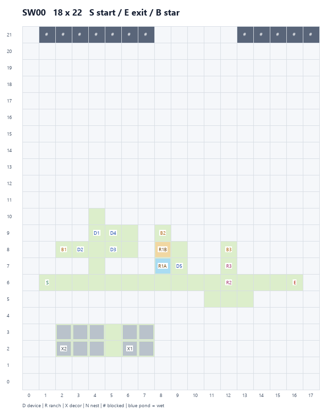

```text
→→→↑↑↑↑→↓←←←←←←→→↓↓→→→→→↑←↑↓↓↓→→→↓→↑↑↑↑↓↓→→→→
```

## SW01

화면 **SW02**. 현재 제목: 1-1. 별돌을 소켓에 넣는 접근과 병아리 점유를 함께 본다. 짧은 통로에서도 제자리 밀기는 별도 입력으로 계산한다.

12×20 격자, 시작 (2,3), 출구 (10,16), 별 3개 / 목표 3개. 정적 바닥 64칸, 연결 영역 1개, 분기 칸 17개, 막다른 칸 7개다.

장치: StarSocket 2, Chick 1, OneWayGate 1.

최단 **54입력**, 기본 조작량 **W0=55**. 이동·기타 52회, 물체 밀기 2회.

양 소모 0마리, 병아리 귀환 0회, 주사위 목표 흡수 0회, 도미노 접힘 0조각, 유리 제거 0개. 이동 없는 유효 입력 2회, 명시 무료 바람 0회다.

[전체 장치 좌표](ANIMOL_MAP_LAYOUT_REPORT.md#sw01) · [입력별 판정 기록](Validation/MapDesign/route_analysis.json)

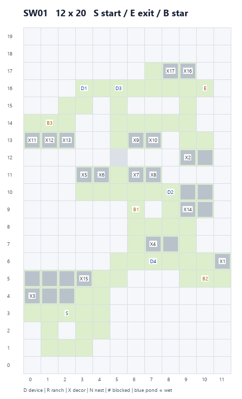

```text
→↑→↑→↑→→→→↓↑←↑↑←←←↑↑←↑↑↑↑→→→→↑↑←←←←←←←←↓←↓←→↑→↑→→→→→→→
```

## SW02

화면 **SW03**. 현재 제목: 초승달의 첫 귀환. 선택 경로에서 양 3마리가 소모되고 직접 양 밀기 14회, 물체 밀기 6회가 필요하다. 자원 배정과 접근로 정리의 긴 예다.

18×20 격자, 시작 (2,12), 출구 (11,14), 별 2개 / 목표 2개. 정적 바닥 34칸, 연결 영역 1개, 분기 칸 13개, 막다른 칸 3개다.

장치: MetalCrate 2, Chick 1, tall_grass 4, sheep 3.

최단 **77입력**, 기본 조작량 **W0=87**. 이동·기타 57회, 양 밀기 14회, 물체 밀기 6회.

양 소모 3마리, 병아리 귀환 1회, 주사위 목표 흡수 0회, 도미노 접힘 0조각, 유리 제거 0개. 이동 없는 유효 입력 20회, 명시 무료 바람 0회다.

[전체 장치 좌표](ANIMOL_MAP_LAYOUT_REPORT.md#sw02) · [입력별 판정 기록](Validation/MapDesign/route_analysis.json)

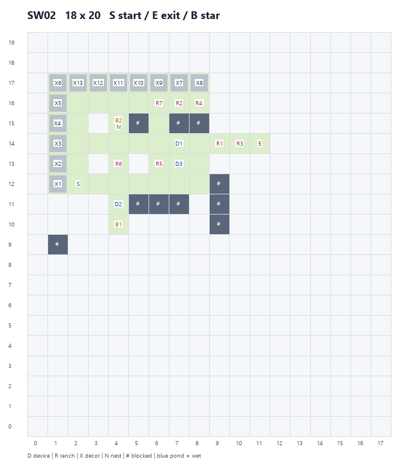

```text
→→→→↑↑↑↑←←←←↓↓→→↓↓↑↑→→→→↑↑←←←←←←←←↑↑→→→↓←←↓↓←→→→→→→←↓↓←←↑←←↑↑↑→→→→→→→→→→→→→→→
```

## SW03

화면 **SW04**. 현재 제목: 네 갈래 방울 마당. 별 4개 중 3개가 목표다. 어느 별을 수집할지 선택하는 분기와 양·수문의 상태 변화를 참고한다.

18×20 격자, 시작 (10,17), 출구 (2,10), 별 4개 / 목표 3개. 정적 바닥 48칸, 연결 영역 1개, 분기 칸 16개, 막다른 칸 4개다.

장치: Chick 1, tall_grass 2, sluice 2, sheep 1.

최단 **41입력**, 기본 조작량 **W0=43.75**. 이동·기타 36회, 양 밀기 4회, 수문 교차 1회.

양 소모 1마리, 병아리 귀환 0회, 주사위 목표 흡수 0회, 도미노 접힘 0조각, 유리 제거 0개. 이동 없는 유효 입력 4회, 명시 무료 바람 0회다.

[전체 장치 좌표](ANIMOL_MAP_LAYOUT_REPORT.md#sw03) · [입력별 판정 기록](Validation/MapDesign/route_analysis.json)

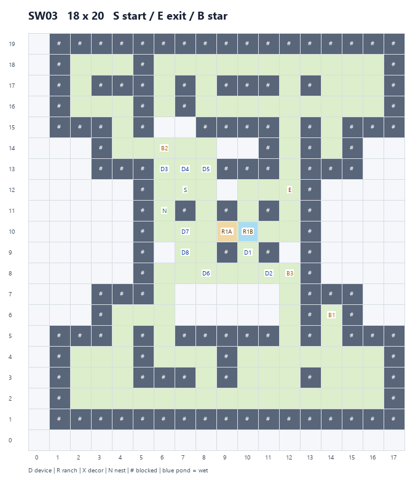

```text
↓←←←↑←←↓↓↓↓↓↓↓↓↓→→↑↓→↓←↑←←↑↑↑←←↓↓←←↑↑↓↓↓↓
```

## SW04

화면 **SW05**. 현재 제목: 고리 안쪽의 풀밭. 넓은 바닥 안에 별돌·상자·양·수문을 둔다. 면적보다 물체를 밀러 돌아가는 접근 순서를 본다.

18×20 격자, 시작 (5,10), 출구 (13,10), 별 3개 / 목표 3개. 정적 바닥 137칸, 연결 영역 2개, 분기 칸 51개, 막다른 칸 13개다.

장치: StarSocket 2, MetalCrate 3, Chick 1, tall_grass 1, sheep 1, sluice 1.

최단 **49입력**, 기본 조작량 **W0=55**. 이동·기타 38회, 양 밀기 3회, 물체 밀기 6회, 수문 교차 2회.

양 소모 1마리, 병아리 귀환 0회, 주사위 목표 흡수 0회, 도미노 접힘 0조각, 유리 제거 0개. 이동 없는 유효 입력 9회, 명시 무료 바람 0회다.

[전체 장치 좌표](ANIMOL_MAP_LAYOUT_REPORT.md#sw04) · [입력별 판정 기록](Validation/MapDesign/route_analysis.json)

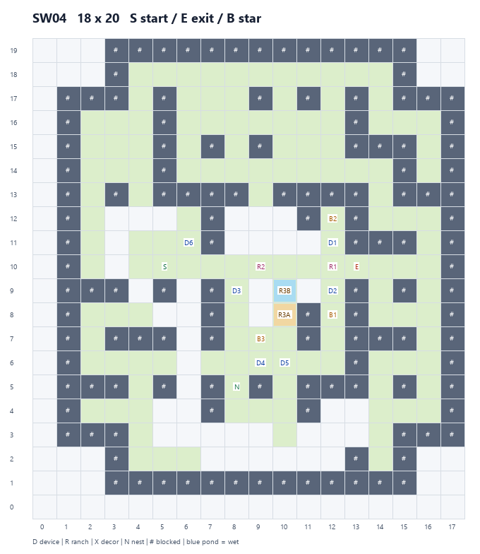

```text
→→→→→→←↓↓↓↓↓↓→→↑↑↑→←←↓↓↓→←↑↑↑→→↓↓↓↓↓→→↑↑↑↑↑↑↑↑↓↓→
```

## SW05

화면 **SW06**. 현재 제목: 모래시계의 두 입구. 별 3개 중 2개가 목표다. 선택 경로에는 수문 교차 3회와 물체 밀기 6회가 들어간다.

18×20 격자, 시작 (7,12), 출구 (12,12), 별 3개 / 목표 2개. 정적 바닥 124칸, 연결 영역 1개, 분기 칸 51개, 막다른 칸 4개다.

장치: StarSocket 2, MetalCrate 5, Chick 1, sluice 1.

최단 **47입력**, 기본 조작량 **W0=52.25**. 이동·기타 38회, 물체 밀기 6회, 수문 교차 3회.

양 소모 0마리, 병아리 귀환 1회, 주사위 목표 흡수 0회, 도미노 접힘 0조각, 유리 제거 0개. 이동 없는 유효 입력 6회, 명시 무료 바람 0회다.

[전체 장치 좌표](ANIMOL_MAP_LAYOUT_REPORT.md#sw05) · [입력별 판정 기록](Validation/MapDesign/route_analysis.json)

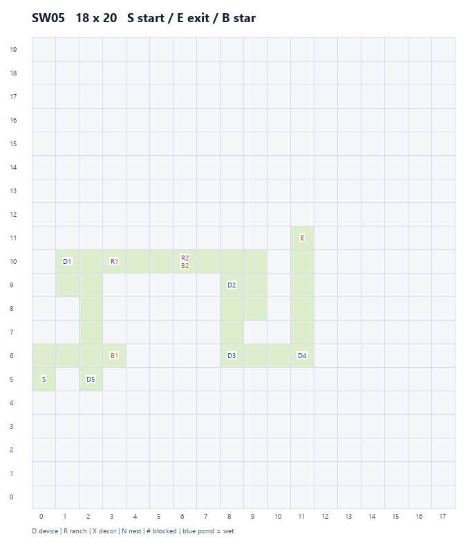

```text
→↑↓↓→→↓←←↓↑↑↑←←↑↑→→↑←←→↓↓→↓↓↓↓→→→→→←←←←↑↑→→↑↑→→
```

## SW06

화면 **SW07**. 현재 제목: 계단 구름 수문. 풍차 단계 변경과 무료 바람 한 번이 있는 예다. 직접 양 밀기는 1회지만 바람 반응까지 포함해 양 2마리가 소모된다.

18×20 격자, 시작 (4,2), 출구 (8,9), 별 2개 / 목표 2개. 정적 바닥 62칸, 연결 영역 1개, 분기 칸 25개, 막다른 칸 3개다.

장치: Wind 1, Bounce 1, Chick 1, MetalCrate 2, OneWayGate 1, tall_grass 2, sheep 2.

최단 **31입력**, 기본 조작량 **W0=35.5**. 이동·기타 24회, 풍차 설정 2회, 물체 밀기 4회, 양 밀기 1회.

양 소모 2마리, 병아리 귀환 1회, 주사위 목표 흡수 0회, 도미노 접힘 0조각, 유리 제거 0개. 이동 없는 유효 입력 7회, 명시 무료 바람 1회다.

[전체 장치 좌표](ANIMOL_MAP_LAYOUT_REPORT.md#sw06) · [입력별 판정 기록](Validation/MapDesign/route_analysis.json)

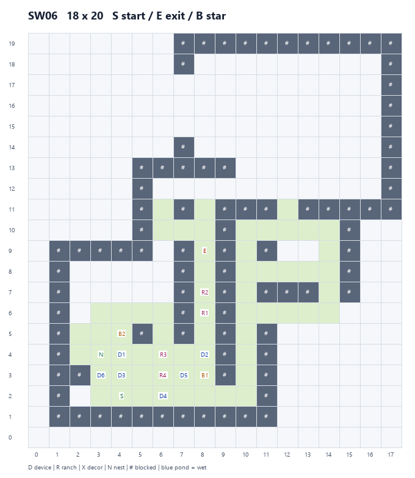

```text
→↑↑←←○←↑↑←←↓←←↓→↓→→→→↑→→→→↑←←↑↑↑
```

## SW07

화면 **SW08**. 현재 제목: 바람 끝의 제동 방울. 별돌과 양 조작 사이에 풍차 설정과 무료 바람을 섞는다. 기다림 기호를 유료 방향 입력과 구분한다.

18×22 격자, 시작 (6,10), 출구 (8,3), 별 3개 / 목표 3개. 정적 바닥 50칸, 연결 영역 2개, 분기 칸 15개, 막다른 칸 7개다.

장치: Chick 1, Wind 1, StarSocket 2, MetalCrate 2, sheep 1, tall_grass 1.

최단 **40입력**, 기본 조작량 **W0=44.5**. 이동·기타 32회, 물체 밀기 5회, 풍차 설정 1회, 양 밀기 2회.

양 소모 1마리, 병아리 귀환 1회, 주사위 목표 흡수 0회, 도미노 접힘 0조각, 유리 제거 0개. 이동 없는 유효 입력 8회, 명시 무료 바람 1회다.

[전체 장치 좌표](ANIMOL_MAP_LAYOUT_REPORT.md#sw07) · [입력별 판정 기록](Validation/MapDesign/route_analysis.json)

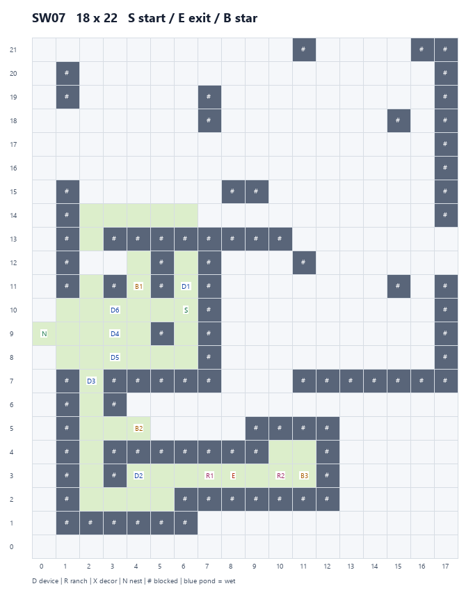

```text
←←↑↓↓←↑←←←←↓↓↓←↓→↓↓↓→→←←↓↓↓→→↑→↑→○→→→→←←←
```

## SW08

화면 **SW09**. 현재 제목: 말굽 정원 돌아오기. 병아리 3마리와 수문 4쌍을 배치했다. 선택 경로에는 수문 교차 2회와 병아리 귀환 1회가 있으며 풍차 단계 변경은 없다.

18×20 격자, 시작 (4,5), 출구 (7,2), 별 2개 / 목표 2개. 정적 바닥 53칸, 연결 영역 2개, 분기 칸 31개, 막다른 칸 3개다.

장치: Chick 3, OneWayGate 2, Wind 1, MetalCrate 1, sluice 4.

최단 **41입력**, 기본 조작량 **W0=42.5**. 이동·기타 39회, 수문 교차 2회.

양 소모 0마리, 병아리 귀환 1회, 주사위 목표 흡수 0회, 도미노 접힘 0조각, 유리 제거 0개. 이동 없는 유효 입력 0회, 명시 무료 바람 0회다.

[전체 장치 좌표](ANIMOL_MAP_LAYOUT_REPORT.md#sw08) · [입력별 판정 기록](Validation/MapDesign/route_analysis.json)

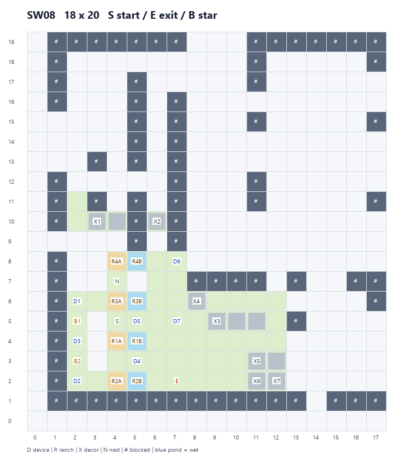

```text
↑←→↓↓↑↑←←↓↑→→↑↑→→↓↓↓↓↓←↓←→↑↑↑↑←←↓↓↓↓→→→→→
```

## SW09

화면 **SW10**. 현재 제목: 굽이길의 선택 샛길. 풍차 3대의 단계 변경이 선택 경로에서 8회다. 여러 풍차의 설정값을 기억하는 부담과 단순 이동량을 구분한다.

18×20 격자, 시작 (15,10), 출구 (16,6), 별 3개 / 목표 3개. 정적 바닥 61칸, 연결 영역 1개, 분기 칸 35개, 막다른 칸 4개다.

장치: Wind 3, StarSocket 2, Conveyor 2, tall_grass 5, sheep 3, sluice 3.

최단 **63입력**, 기본 조작량 **W0=75.5**. 이동·기타 47회, 풍차 설정 8회, 수문 교차 2회, 물체 밀기 2회, 양 밀기 4회.

양 소모 3마리, 병아리 귀환 0회, 주사위 목표 흡수 0회, 도미노 접힘 0조각, 유리 제거 0개. 이동 없는 유효 입력 14회, 명시 무료 바람 0회다.

[전체 장치 좌표](ANIMOL_MAP_LAYOUT_REPORT.md#sw09) · [입력별 판정 기록](Validation/MapDesign/route_analysis.json)

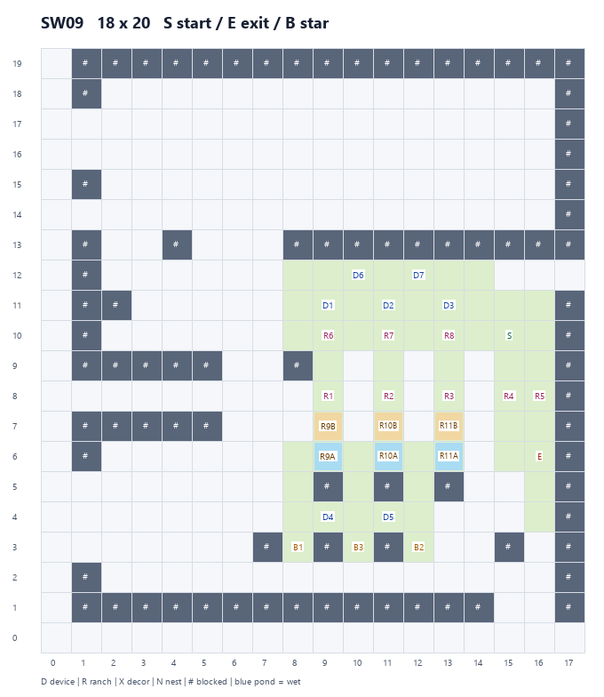

```text
↑←↑←←↓↓↓↓←←↓→→→→↓→↓↓↓↓←↓↓↓↑→→→→↓↑→→↓↑←←↑↑←↑↑↑↑→→→→→→→↑→↓↓↓↓↓↓→↓
```

## SW10

화면 **SW11**. 현재 제목: 네 잎 정류장. 풍차·무빙워크·양·별돌이 함께 있다. 제자리 조작과 자동 이동이 섞여 정답 입력 수와 실제 이동량이 달라진다.

18×20 격자, 시작 (5,7), 출구 (14,10), 별 3개 / 목표 3개. 정적 바닥 41칸, 연결 영역 1개, 분기 칸 29개, 막다른 칸 4개다.

장치: Wind 1, StarSocket 2, MetalCrate 1, Conveyor 1, sheep 3, tall_grass 1.

최단 **45입력**, 기본 조작량 **W0=52**. 이동·기타 32회, 양 밀기 7회, 물체 밀기 5회, 풍차 설정 1회.

양 소모 1마리, 병아리 귀환 0회, 주사위 목표 흡수 0회, 도미노 접힘 0조각, 유리 제거 0개. 이동 없는 유효 입력 13회, 명시 무료 바람 1회다.

[전체 장치 좌표](ANIMOL_MAP_LAYOUT_REPORT.md#sw10) · [입력별 판정 기록](Validation/MapDesign/route_analysis.json)

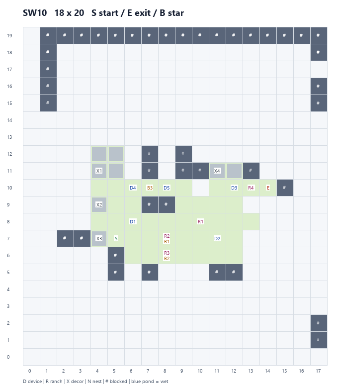

```text
→→↑→○↓→→↑↓→↑↑↑↑↑←←↑→←↑←←←↓←↓↓→↑→↓→→↑↑↑↑↑←↑→→→→
```

## SW11

화면 **SW12**. 현재 제목: 삼지창의 두 바람 높이. 병아리 2마리가 모두 귀환하는 짧은 예다. 긴 복도 없이 추종 순서와 일방통행을 조합하는 참고로 본다.

18×20 격자, 시작 (6,2), 출구 (8,5), 별 2개 / 목표 2개. 정적 바닥 27칸, 연결 영역 2개, 분기 칸 9개, 막다른 칸 6개다.

장치: Chick 2, OneWayGate 1.

최단 **30입력**, 기본 조작량 **W0=30**. 이동·기타 30회.

양 소모 0마리, 병아리 귀환 2회, 주사위 목표 흡수 0회, 도미노 접힘 0조각, 유리 제거 0개. 이동 없는 유효 입력 0회, 명시 무료 바람 0회다.

[전체 장치 좌표](ANIMOL_MAP_LAYOUT_REPORT.md#sw11) · [입력별 판정 기록](Validation/MapDesign/route_analysis.json)

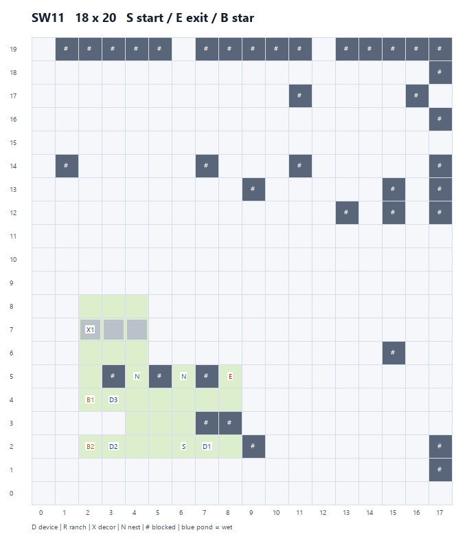

```text
↑↑←↓↓←↑↑→↓↓←←←→→↑↑↑↑←←↓↓→→→→→↑
```

## SW12

화면 **SW13**. 현재 제목: 대각선 날개의 급식 순서. 별 1개 목표에 소켓과 상자, 양 소모, 병아리 귀환을 배치했다. 적은 수집 목표에도 상태 의존을 만들 수 있다.

18×22 격자, 시작 (15,16), 출구 (8,13), 별 1개 / 목표 1개. 정적 바닥 40칸, 연결 영역 2개, 분기 칸 25개, 막다른 칸 4개다.

장치: StarSocket 2, MetalCrate 2, Chick 1, sheep 1, tall_grass 1.

최단 **31입력**, 기본 조작량 **W0=34.5**. 이동·기타 24회, 물체 밀기 4회, 양 밀기 3회.

양 소모 1마리, 병아리 귀환 1회, 주사위 목표 흡수 0회, 도미노 접힘 0조각, 유리 제거 0개. 이동 없는 유효 입력 7회, 명시 무료 바람 0회다.

[전체 장치 좌표](ANIMOL_MAP_LAYOUT_REPORT.md#sw12) · [입력별 판정 기록](Validation/MapDesign/route_analysis.json)

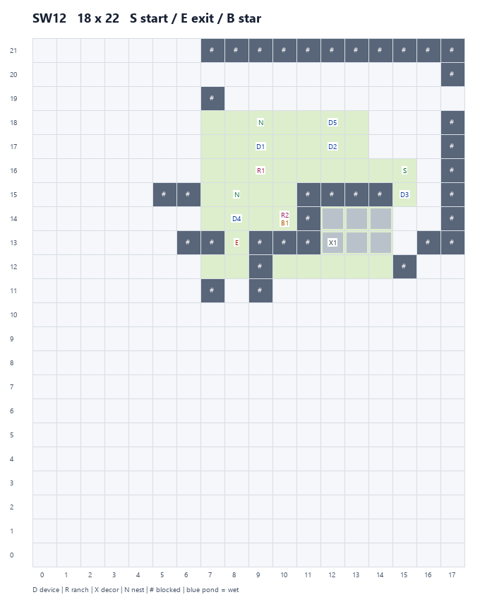

```text
←←←←↑←←←↓→↓←↓←←↑↑→↓↓↓↓↓↓↓→→→←←↓
```

## SW13

화면 **SW14**. 현재 제목: 협곡의 왕복 수문. 28개의 정적 바닥 칸에 상자·소켓·병아리·양을 배치한 압축형 예다. 작은 면적과 짧은 입력 수가 상태 단순함을 뜻하지 않는다.

18×22 격자, 시작 (10,15), 출구 (6,11), 별 1개 / 목표 1개. 정적 바닥 28칸, 연결 영역 1개, 분기 칸 22개, 막다른 칸 3개다.

장치: StarSocket 2, MetalCrate 4, Chick 1, tall_grass 1, sheep 1.

최단 **29입력**, 기본 조작량 **W0=30.5**. 이동·기타 26회, 물체 밀기 2회, 양 밀기 1회.

양 소모 1마리, 병아리 귀환 1회, 주사위 목표 흡수 0회, 도미노 접힘 0조각, 유리 제거 0개. 이동 없는 유효 입력 3회, 명시 무료 바람 0회다.

[전체 장치 좌표](ANIMOL_MAP_LAYOUT_REPORT.md#sw13) · [입력별 판정 기록](Validation/MapDesign/route_analysis.json)

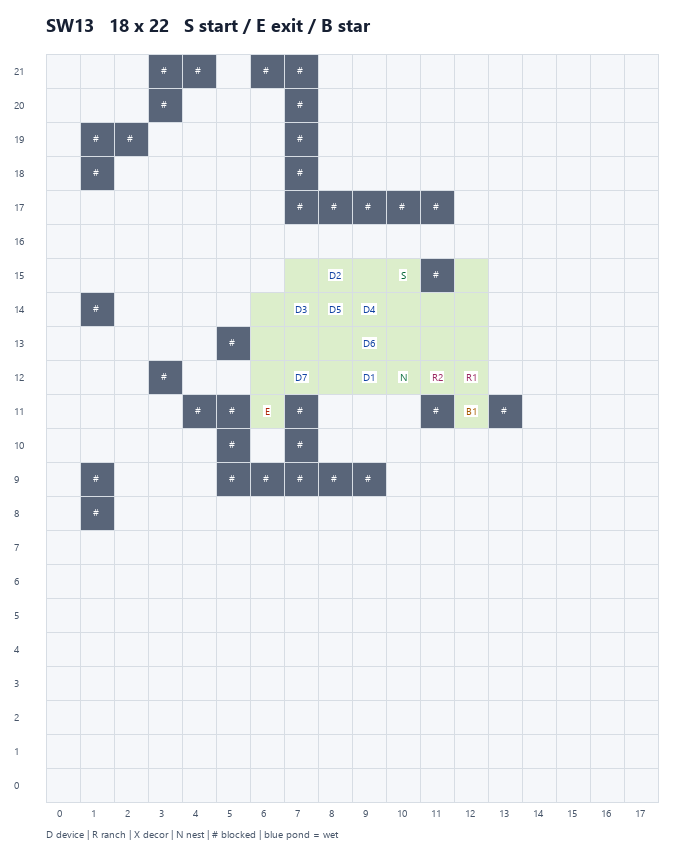

```text
↓↓←←←←↓↑→→↑↑↓↓↓→→→↓↑↑←←←←↓←←↓
```

## SW14

화면 **SW15**. 현재 제목: 세 앞마당의 두 행렬. 병아리 3마리와 금속 상자 3개가 있고 정답은 22입력이다. 짧은 맵에서 통로 점유 순서를 비교하는 예다.

18×22 격자, 시작 (10,6), 출구 (8,9), 별 1개 / 목표 1개. 정적 바닥 26칸, 연결 영역 2개, 분기 칸 13개, 막다른 칸 6개다.

장치: Chick 3, MetalCrate 3.

최단 **22입력**, 기본 조작량 **W0=23.5**. 이동·기타 19회, 물체 밀기 3회.

양 소모 0마리, 병아리 귀환 1회, 주사위 목표 흡수 0회, 도미노 접힘 0조각, 유리 제거 0개. 이동 없는 유효 입력 3회, 명시 무료 바람 0회다.

[전체 장치 좌표](ANIMOL_MAP_LAYOUT_REPORT.md#sw14) · [입력별 판정 기록](Validation/MapDesign/route_analysis.json)

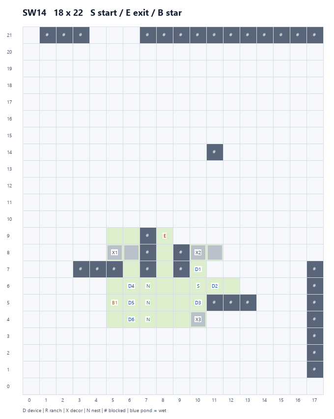

```text
←↓←↑↑↓↓←←←↑↑←↓↓→→→↑↑↑↑
```

## SW15

화면 **SW16**. 현재 제목: 두 번 꺾이는 바람의 뜰. 별돌/소켓 4개 항목과 병아리 2마리를 함께 놓았다. 선택 경로의 물체 밀기는 10회이며 두 병아리가 귀환한다.

18×22 격자, 시작 (15,15), 출구 (8,16), 별 1개 / 목표 1개. 정적 바닥 66칸, 연결 영역 5개, 분기 칸 27개, 막다른 칸 10개다.

장치: StarSocket 4, Chick 2, MetalCrate 1.

최단 **52입력**, 기본 조작량 **W0=57**. 이동·기타 42회, 물체 밀기 10회.

양 소모 0마리, 병아리 귀환 2회, 주사위 목표 흡수 0회, 도미노 접힘 0조각, 유리 제거 0개. 이동 없는 유효 입력 10회, 명시 무료 바람 0회다.

[전체 장치 좌표](ANIMOL_MAP_LAYOUT_REPORT.md#sw15) · [입력별 판정 기록](Validation/MapDesign/route_analysis.json)

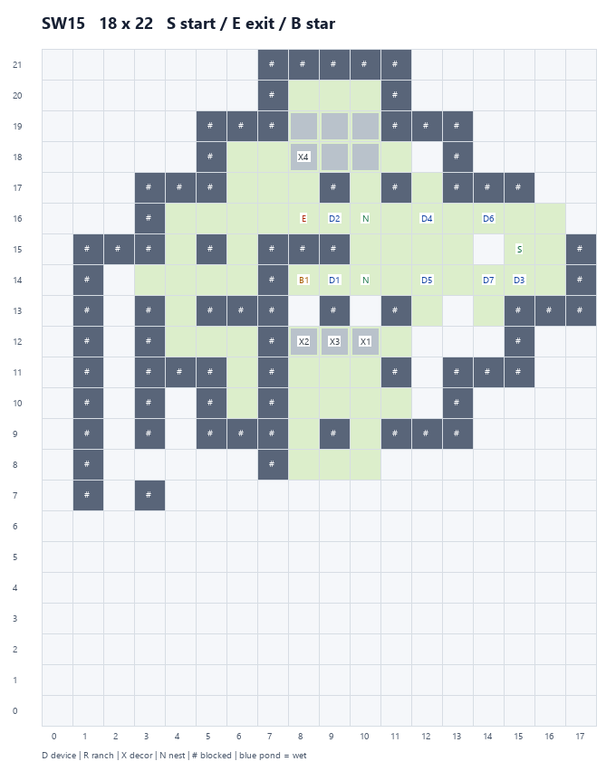

```text
→↓←↑↑→↓←↓←←↑←←↓→→↑→↑→←→→→↓↓←←←←←←←←↑←↓←←→→↑→→↑←←←←←←
```

## SW16

화면 **SW17**. 현재 제목: 바람을 꺾는 연섬. 양 5마리와 풀 12곳 중 선택 경로는 양 3마리를 소모한다. 별 4개 중 3개 목표여서 선택 자원과 선택 수집을 함께 본다.

18×22 격자, 시작 (11,10), 출구 (14,15), 별 4개 / 목표 3개. 정적 바닥 39칸, 연결 영역 1개, 분기 칸 28개, 막다른 칸 1개다.

장치: sheep 5, tall_grass 12.

최단 **35입력**, 기본 조작량 **W0=39.5**. 양 밀기 9회, 이동·기타 26회.

양 소모 3마리, 병아리 귀환 0회, 주사위 목표 흡수 0회, 도미노 접힘 0조각, 유리 제거 0개. 이동 없는 유효 입력 9회, 명시 무료 바람 0회다.

[전체 장치 좌표](ANIMOL_MAP_LAYOUT_REPORT.md#sw16) · [입력별 판정 기록](Validation/MapDesign/route_analysis.json)

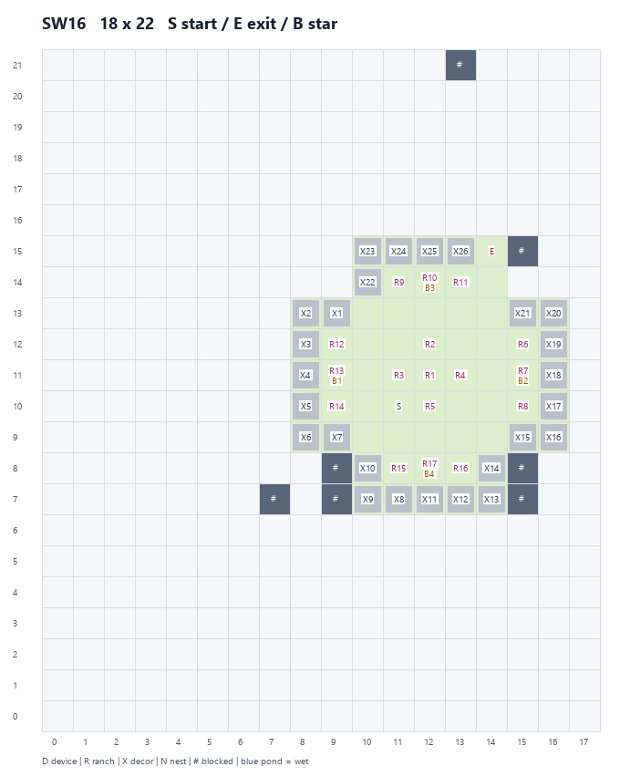

```text
↑↓→→↑↑↑←←↓↓↓↓↓↑↑↑←←←←←→→→↑↑↑↑↑↓→→↑↑
```

## SW17

화면 **SW18**. 현재 제목: 쌍고리의 두 둥지. 양 2마리와 풀 6곳, 병아리와 상자를 둔다. 두 양을 소비하는 지점의 배정과 병아리 귀환을 맞추는 참고다.

18×22 격자, 시작 (9,7), 출구 (16,7), 별 3개 / 목표 3개. 정적 바닥 36칸, 연결 영역 1개, 분기 칸 26개, 막다른 칸 2개다.

장치: Chick 1, MetalCrate 6, tall_grass 6, sheep 2.

최단 **64입력**, 기본 조작량 **W0=73.5**. 이동·기타 45회, 물체 밀기 7회, 양 밀기 12회.

양 소모 2마리, 병아리 귀환 1회, 주사위 목표 흡수 0회, 도미노 접힘 0조각, 유리 제거 0개. 이동 없는 유효 입력 19회, 명시 무료 바람 0회다.

[전체 장치 좌표](ANIMOL_MAP_LAYOUT_REPORT.md#sw17) · [입력별 판정 기록](Validation/MapDesign/route_analysis.json)

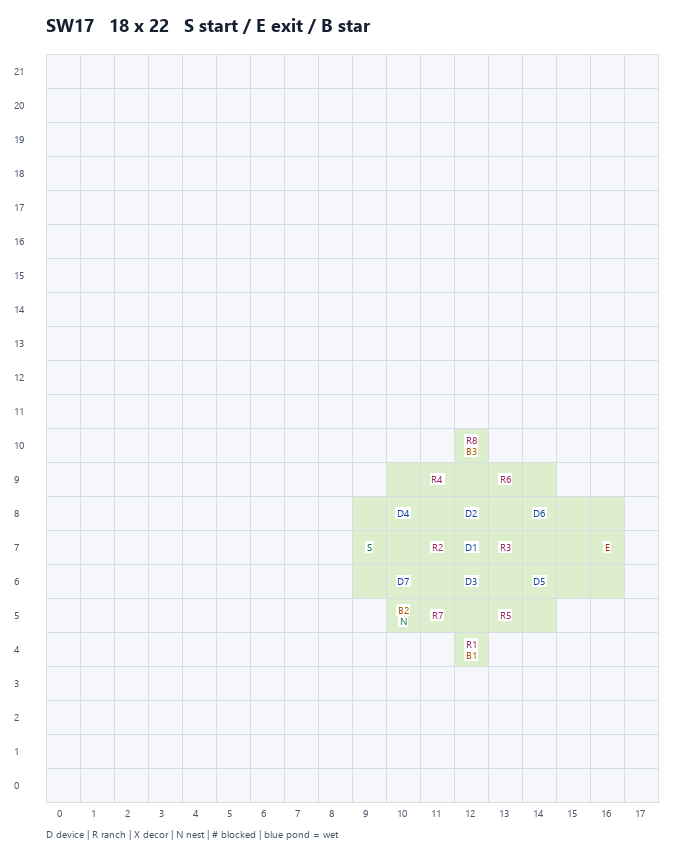

```text
→↑↑→→→←←↓→→↓←←↑↑↓↓↓↑→→→↑↑↑→→→→↑↑→→↓←←←←←↑←←←←↑↑↑↓↓↓↓↓↓↓↓↓↑↑↑→→→→
```

## SW18

화면 **SW19**. 현재 제목: 왕관 능선의 교환 순서. 병아리 4마리와 양 4마리, 풀 5곳이 있다. 선택 경로에서는 병아리 3마리가 귀환하고 양 1마리가 소모된다.

18×22 격자, 시작 (7,10), 출구 (2,6), 별 1개 / 목표 1개. 정적 바닥 36칸, 연결 영역 1개, 분기 칸 32개, 막다른 칸 0개다.

장치: Chick 4, sheep 4, tall_grass 5.

최단 **32입력**, 기본 조작량 **W0=33.5**. 이동·기타 29회, 양 밀기 3회.

양 소모 1마리, 병아리 귀환 3회, 주사위 목표 흡수 0회, 도미노 접힘 0조각, 유리 제거 0개. 이동 없는 유효 입력 3회, 명시 무료 바람 0회다.

[전체 장치 좌표](ANIMOL_MAP_LAYOUT_REPORT.md#sw18) · [입력별 판정 기록](Validation/MapDesign/route_analysis.json)

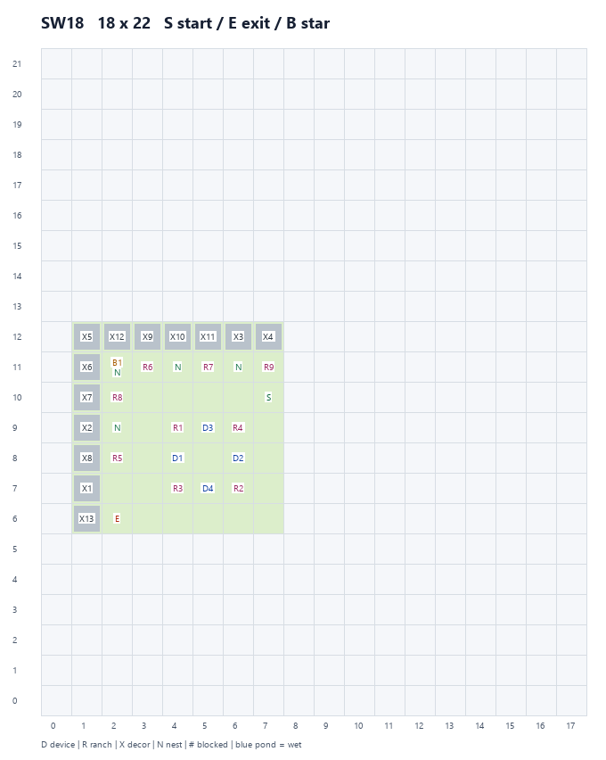

```text
←←←←↓↓↑↑→→↓←↓←←↑↑↑↑↑→↓↑←←→↓↓↓↓↓←
```

## SW19

화면 **SW20**. 현재 제목: 짧은 바람과 긴 바람의 회랑. 풍차 1대·반사판 3개와 양·수문·병아리를 결합했다. 반사판의 열린 면과 무료/동기 바람 순서를 유지해야 한다.

18×22 격자, 시작 (15,9), 출구 (8,9), 별 2개 / 목표 2개. 정적 바닥 44칸, 연결 영역 1개, 분기 칸 34개, 막다른 칸 2개다.

장치: Wind 1, Bounce 3, MetalCrate 1, Chick 1, sheep 3, tall_grass 4, sluice 1.

최단 **60입력**, 기본 조작량 **W0=69**. 이동·기타 44회, 양 밀기 13회, 수문 교차 2회, 풍차 설정 1회.

양 소모 3마리, 병아리 귀환 1회, 주사위 목표 흡수 0회, 도미노 접힘 0조각, 유리 제거 0개. 이동 없는 유효 입력 14회, 명시 무료 바람 0회다.

[전체 장치 좌표](ANIMOL_MAP_LAYOUT_REPORT.md#sw19) · [입력별 판정 기록](Validation/MapDesign/route_analysis.json)

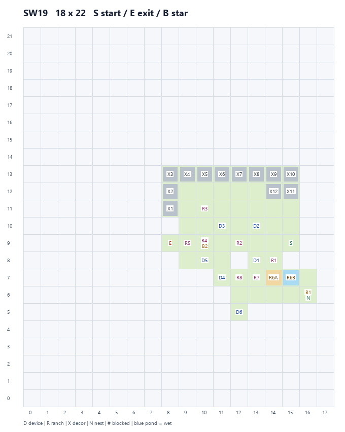

```text
←↑↑←←←↑←←↓→→→→↑→↓↓↓↓→→↑→↓↑→↓↑←←↑↑↑←↑←←←←↑↑→→↓↓→↓←←←←←←←←←←←←
```

## ET-00

화면 **ET-02**. 현재 제목: 소품 운반로. 셔터와 주사위, 방향성 도미노를 결합한다. 주사위 밀기 2회와 도미노 직접 밀기 1회로 목표 흡수와 조각 2개 접힘이 일어난다.

18×20 격자, 시작 (1,4), 출구 (13,4), 별 3개 / 목표 3개. 정적 바닥 29칸, 연결 영역 4개, 분기 칸 11개, 막다른 칸 6개다.

장치: Dice 2, Domino 2, Glass 1, Shutter 1.

최단 **31입력**, 기본 조작량 **W0=34.75**. 이동·기타 28회, 주사위 밀기 2회, 도미노 밀기 1회.

양 소모 0마리, 병아리 귀환 0회, 주사위 목표 흡수 1회, 도미노 접힘 2조각, 유리 제거 0개. 이동 없는 유효 입력 3회, 명시 무료 바람 0회다.

[전체 장치 좌표](ANIMOL_MAP_LAYOUT_REPORT.md#et-00) · [입력별 판정 기록](Validation/MapDesign/route_analysis.json)

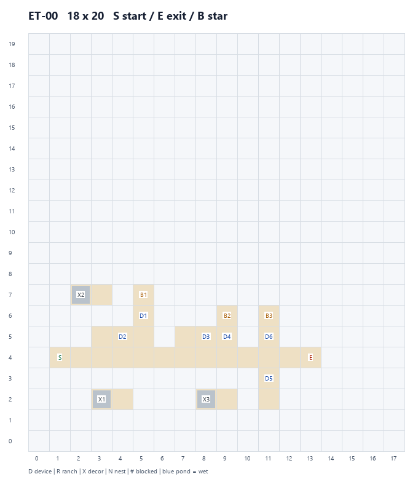

```text
→→↑→→↓→↑↑↑↑↓↓↓→→↑→→→↑↓↓→→↑↑↓↓→→
```

## ET-01

화면 **ET-01**. 현재 제목: 개막 전 셔터. 카트 1대와 셔터, 주사위·도미노를 둔다. 선택 경로의 주사위 밀기는 5회이며 주사위 목표 흡수는 1회다.

18×20 격자, 시작 (9,9), 출구 (12,11), 별 2개 / 목표 2개. 정적 바닥 37칸, 연결 영역 1개, 분기 칸 23개, 막다른 칸 5개다.

장치: Dice 3, MovingStage 1, Domino 3, Shutter 1, Glass 1.

최단 **42입력**, 기본 조작량 **W0=50.25**. 이동·기타 36회, 주사위 밀기 5회, 도미노 밀기 1회.

양 소모 0마리, 병아리 귀환 0회, 주사위 목표 흡수 1회, 도미노 접힘 3조각, 유리 제거 0개. 이동 없는 유효 입력 7회, 명시 무료 바람 0회다.

[전체 장치 좌표](ANIMOL_MAP_LAYOUT_REPORT.md#et-01) · [입력별 판정 기록](Validation/MapDesign/route_analysis.json)

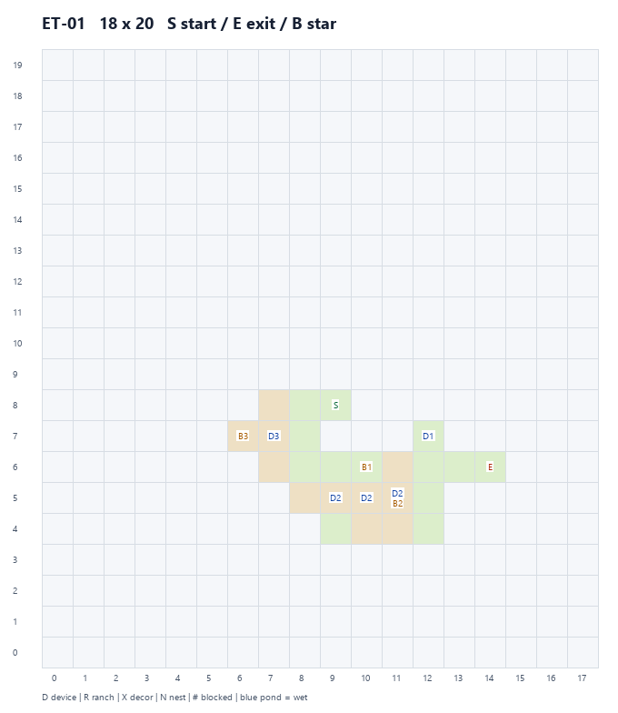

```text
→↑→→↓→↓↓←↑←←↓←↓↓→←←←↑↑↑→→→→↑↓↓↓→↓→→→→←↑↑↑↑
```

## ET-03

화면 **ET-03**. 현재 제목: 옆에서 접는 가림벽. 카트 2대의 선로와 주사위 접근을 결합한다. 선택 경로에서 카트가 플레이어를 미는 사건이 1회 있다.

18×20 격자, 시작 (0,4), 출구 (6,8), 별 2개 / 목표 2개. 정적 바닥 38칸, 연결 영역 1개, 분기 칸 17개, 막다른 칸 2개다.

장치: Dice 2, MovingStage 2, Glass 1.

최단 **49입력**, 기본 조작량 **W0=59.5**. 이동·기타 42회, 주사위 밀기 7회.

양 소모 0마리, 병아리 귀환 0회, 주사위 목표 흡수 1회, 도미노 접힘 0조각, 유리 제거 0개. 이동 없는 유효 입력 7회, 명시 무료 바람 0회다.

[전체 장치 좌표](ANIMOL_MAP_LAYOUT_REPORT.md#et-03) · [입력별 판정 기록](Validation/MapDesign/route_analysis.json)

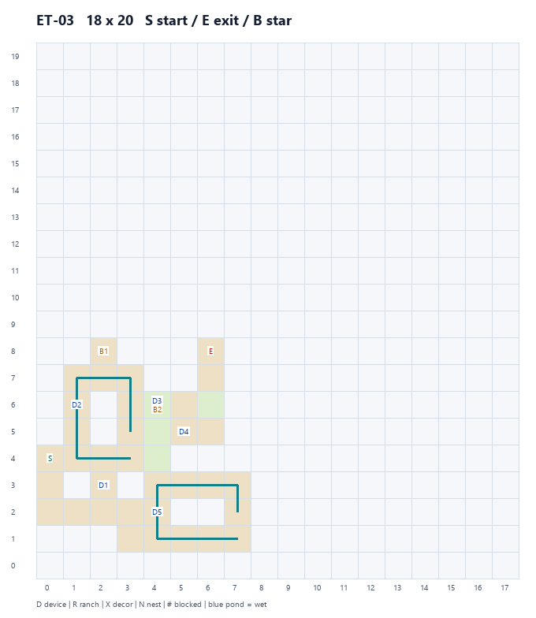

```text
→→↓↑→↓←↑↑→↑←↑↓←↓↓↓←↓↓→→→→→↓→↑↑↑↓←↑→↑↑↑←↑→↑→↓→→↑↑↑
```

## ET-04

화면 **ET-04**. 현재 제목: 책장 뒤 첫 방울. 겁쟁이 인형 3개와 카트, 주사위를 둔다. 선택 경로는 주사위를 한 번 밀지만 목표 숫자 흡수 없이 승리한다.

18×20 격자, 시작 (3,2), 출구 (8,9), 별 2개 / 목표 2개. 정적 바닥 33칸, 연결 영역 1개, 분기 칸 21개, 막다른 칸 0개다.

장치: CowardDoll 3, Dice 2, MovingStage 1.

최단 **33입력**, 기본 조작량 **W0=34.5**. 이동·기타 32회, 주사위 밀기 1회.

양 소모 0마리, 병아리 귀환 0회, 주사위 목표 흡수 0회, 도미노 접힘 0조각, 유리 제거 0개. 이동 없는 유효 입력 1회, 명시 무료 바람 0회다.

[전체 장치 좌표](ANIMOL_MAP_LAYOUT_REPORT.md#et-04) · [입력별 판정 기록](Validation/MapDesign/route_analysis.json)

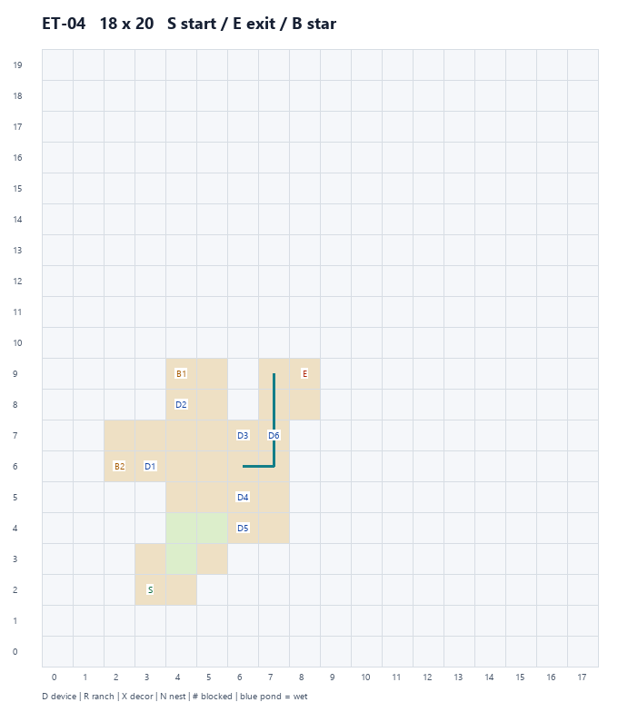

```text
↑→↑→→↑↑↑↑↑←↓↓←←↓↑→→→↓↓↑→→↑←←→→↑↑→
```

## ET-05

화면 **ET-05**. 현재 제목: 숫자를 돌리는 첫 길. 석상 4개·유리 2개·도미노 2개를 배치했다. 선택 경로는 한 번의 석상 돌진을 포함하지만 유리는 제거하지 않는다.

18×20 격자, 시작 (7,5), 출구 (12,10), 별 2개 / 목표 2개. 정적 바닥 42칸, 연결 영역 1개, 분기 칸 18개, 막다른 칸 4개다.

장치: Statue 4, Glass 2, Domino 2.

최단 **26입력**, 기본 조작량 **W0=26.75**. 이동·기타 25회, 도미노 밀기 1회.

양 소모 0마리, 병아리 귀환 0회, 주사위 목표 흡수 0회, 도미노 접힘 2조각, 유리 제거 0개. 이동 없는 유효 입력 4회, 명시 무료 바람 0회다.

[전체 장치 좌표](ANIMOL_MAP_LAYOUT_REPORT.md#et-05) · [입력별 판정 기록](Validation/MapDesign/route_analysis.json)

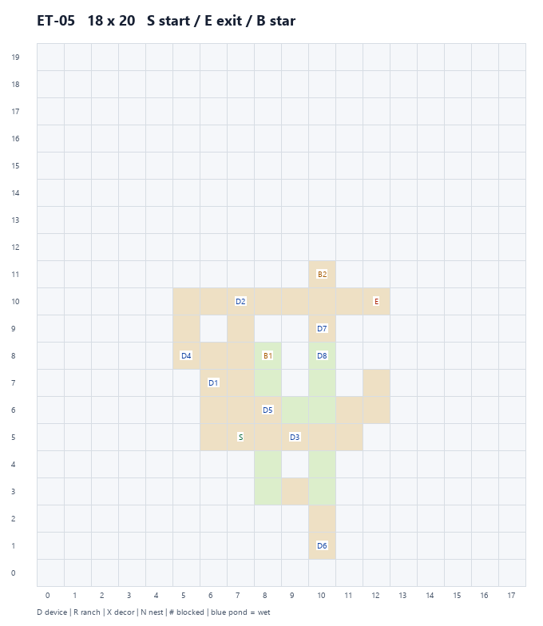

```text
→→→↑←←↓←↑↑→↑↑↓↓→→↑↑↑↑↑↑↓→→
```

## 해석 범위

SW00~19는 화면 SW01~20이다. 원본 ET-02는 없고 화면 ET-02는 위 ET-00이다. 원본 ET-05의 미저장 표시는 유지했으며 이 표는 현재 로드된 상태의 판정 재생에 근거한다.

이 표의 소비·귀환·목표 흡수 횟수는 선택한 정답에서의 실제 사건이다. 설치된 모든 장치가 필수라는 증거로 확대하지 않는다. 주사위 면·카트 위상·병아리 이력 등 자세한 연결 조건은 JSON과 현재 장치 판정을 확인한다.
