# 별길 목장과 잔영 극장 맵 배치 보고서

2026-11-10 정본 커밋 `a2f825e09`의 별길 목장 SW00~SW19·SW21 21개와 잔영 극장 ET-11까지 현존 파일 11개, 총 32개가 대상이다. ET-06은 삭제 상태를 유지한다. SW20은 없고 SW21은 현재 노트북 20개 진입 목록 밖이다. 현재 파일 ID와 화면 연결을 구분한다.

좌표는 왼쪽 아래가 `(0,0)`, 오른쪽이 +x, 위가 +y다. 배치도는 현재 Unity 데이터로 만든 초기 배치도이며 플레이 화면 캡처가 아니다. `D`는 시나리오 장치, `R`은 양·수문·풀, `X`는 장식 인스턴스, `B`는 별, `S/E`는 시작/출구, `N`은 둥지다. 같은 번호가 여러 칸에 표시되면 하나의 다중 칸 객체다.

32개 모두 미저장 변경이 없으며 정본 GUID·SHA-256과 일치한다. 원본 저장은 실행하지 않았다. 별길 목장 SW00~SW19는 화면 SW01~SW20에 대응한다. SW03은 이전 SW05의 GUID, 새 배치 SW05는 이전 SW03의 GUID를 이어받았다. [현재 최단 경로와 변경 대조](STARWAY_SHORTEST_PATHS.md), [잔영 극장 최단 경로](ECHO_THEATER_SHORTEST_PATHS.md)를 함께 참조한다.

바닥 수에는 장치가 차지한 바닥도 포함한다. `#`는 기록된 통행 불가 지형, 연한 회색 빈칸은 지형 없음, 회색 내부 칸은 장식 점유다. 정적 연결 영역은 `PuzzleMap.Walkable` 기준의 상하좌우 연결 수이며, 다리·수문·물체 이동을 반영한 도달 가능 판정은 아니다.

## 전체 배치 요약

### 별길 목장

| 원본 → 화면 ID | 격자 | 시작 → 출구 | 목표 / 초기 별 | 바닥 / 막힘 | D / R / X | 정적 영역 |
|---|---|---|---|---|---|---|
| [SW00](#sw00) → SW01 | 18×22 | (1,6) → (16,6) | 3 / 3 | 48 / 12 | 5 / 3 / 2 | 2 |
| [SW01](#sw01) → SW02 | 12×20 | (2,3) → (10,16) | 3 / 3 | 91 / 0 | 4 / 0 / 17 | 1 |
| [SW02](#sw02) → SW03 | 18×20 | (2,12) → (11,14) | 2 / 2 | 47 / 10 | 3 / 7 / 13 | 1 |
| [SW03](#sw03) → SW04 | 18×20 | (7,12) → (12,12) | 2 / 3 | 124 / 126 | 8 / 1 / 0 | 1 |
| [SW04](#sw04) → SW05 | 18×20 | (5,10) → (13,10) | 3 / 3 | 137 / 130 | 6 / 3 / 0 | 2 |
| [SW05](#sw05) → SW06 | 18×20 | (0,5) → (11,11) | 2 / 2 | 33 / 0 | 5 / 2 / 0 | 1 |
| [SW06](#sw06) → SW07 | 18×20 | (4,2) → (8,9) | 2 / 2 | 62 / 87 | 6 / 4 / 0 | 1 |
| [SW07](#sw07) → SW08 | 18×22 | (6,10) → (8,3) | 3 / 3 | 50 / 91 | 6 / 2 / 0 | 2 |
| [SW08](#sw08) → SW09 | 18×20 | (4,5) → (7,2) | 2 / 2 | 64 / 78 | 7 / 4 / 7 | 2 |
| [SW09](#sw09) → SW10 | 18×20 | (15,10) → (16,6) | 3 / 3 | 61 / 85 | 7 / 11 / 0 | 1 |
| [SW10](#sw10) → SW11 | 18×20 | (5,7) → (14,10) | 3 / 3 | 49 / 42 | 5 / 4 / 4 | 1 |
| [SW11](#sw11) → SW12 | 18×20 | (6,2) → (8,5) | 2 / 2 | 30 / 38 | 3 / 0 / 1 | 2 |
| [SW12](#sw12) → SW13 | 18×22 | (15,16) → (8,13) | 1 / 1 | 46 / 36 | 5 / 2 / 1 | 2 |
| [SW13](#sw13) → SW14 | 18×22 | (10,15) → (6,11) | 1 / 1 | 28 / 34 | 7 / 2 / 0 | 1 |
| [SW14](#sw14) → SW15 | 18×22 | (10,6) → (8,9) | 1 / 1 | 31 / 33 | 6 / 0 / 3 | 2 |
| [SW15](#sw15) → SW16 | 18×22 | (15,15) → (8,16) | 1 / 1 | 75 / 76 | 7 / 0 / 4 | 5 |
| [SW16](#sw16) → SW17 | 18×22 | (11,10) → (14,15) | 3 / 4 | 65 / 7 | 0 / 17 / 26 | 1 |
| [SW17](#sw17) → SW18 | 18×22 | (9,7) → (16,7) | 3 / 3 | 36 / 0 | 7 / 8 / 0 | 1 |
| [SW18](#sw18) → SW19 | 18×22 | (7,10) → (2,6) | 1 / 1 | 49 / 0 | 4 / 9 / 13 | 1 |
| [SW19](#sw19) → SW20 | 18×22 | (15,9) → (8,9) | 2 / 2 | 56 / 0 | 6 / 8 / 12 | 1 |
| [SW21](#sw21) → 미연결 | 18×22 | (4,18) → (14,2) | 3 / 3 | 136 / 156 | 11 / 4 / 0 | 1 |

### 잔영 극장

| 원본 → 화면 ID | 격자 | 시작 → 출구 | 목표 / 초기 별 | 바닥 / 막힘 | D / R / X | 정적 영역 |
|---|---|---|---|---|---|---|
| [ET-00](#et-00) → ET-02 | 18×20 | (1,4) → (13,4) | 3 / 3 | 32 / 0 | 6 / 0 / 3 | 4 |
| [ET-01](#et-01) → ET-06 | 18×20 | (9,8) → (14,6) | 3 / 3 | 24 / 0 | 3 / 0 / 0 | 1 |
| [ET-02](#et-02) → ET-07 | 18×20 | (1,2) → (6,7) | 3 / 3 | 29 / 0 | 6 / 0 / 0 | 1 |
| [ET-03](#et-03) → ET-03 | 18×20 | (0,4) → (6,8) | 2 / 2 | 38 / 0 | 5 / 0 / 0 | 1 |
| [ET-04](#et-04) → ET-04 | 18×20 | (3,2) → (8,9) | 2 / 2 | 33 / 0 | 6 / 0 / 0 | 1 |
| [ET-05](#et-05) → ET-05 | 18×20 | (7,5) → (12,10) | 2 / 2 | 42 / 0 | 8 / 0 / 0 | 1 |
| ET-06 | 원본 없음 | — | — | — | — | — |
| [ET-07](#et-07) → ET-01 | 18×20 | (9,9) → (12,11) | 2 / 2 | 40 / 0 | 9 / 0 / 3 | 1 |
| [ET-08](#et-08) → ET-08 | 18×20 | (4,2) → (9,9) | 2 / 2 | 33 / 0 | 9 / 0 / 0 | 1 |
| [ET-09](#et-09) → ET-09 | 18×20 | (5,5) → (9,9) | 3 / 3 | 38 / 0 | 10 / 0 / 0 | 1 |
| [ET-10](#et-10) → ET-10 | 18×20 | (1,2) → (5,8) | 2 / 2 | 39 / 0 | 7 / 0 / 0 | 1 |
| [ET-11](#et-11) → ET-11 | 18×20 | (6,2) → (9,10) | 3 / 3 | 44 / 0 | 8 / 0 / 0 | 1 |

## 맵별 배치

### ET-00

시나리오 제목: **소품 운반로**. 화면 연결: **ET-02**. [원본 에셋](../Assets/ANIMOL/Data/Puzzle/MapData/memory_theater/ET-00_MapData.asset).

격자 18×20, 바닥 32칸(극장 무대 바닥 32), 막힌 지형 0칸, 지형 없는 칸 328칸이다. 정적 바닥은 4개 영역으로 나뉜다.

시작 (1,4), 출구 (13,4). 별은 (5,7), (9,6), (11,6)에 있으며 수집 목표는 3개다.

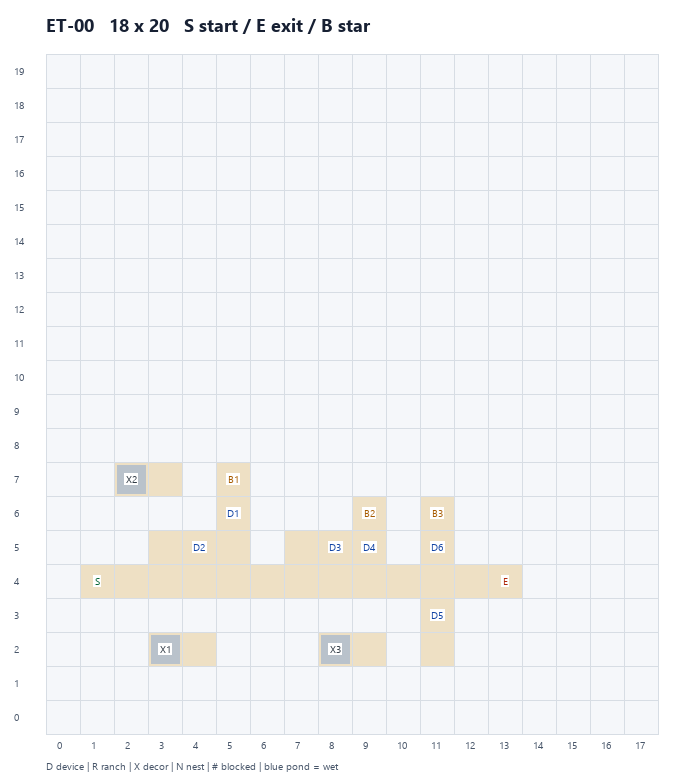

| 표시 | 장치 ID | 종류 | 기준 좌표 | 초기 점유 칸 | 방향과 연결 설정 |
|---|---|---|---|---|---|
| D1 | dice_2 | 주사위 목표 | (5,6) | (5,6) | 변형 target; 목표 윗면 2; 진입 방향 → |
| D2 | dice_4 | 주사위 | (4,5) | (4,5) | 면 [위,아래,북,남,동,서]=1,6,5,2,3,4 |
| D3 | domino_1 | 도미노 | (8,5) | (8,5) | 방향 → |
| D4 | domino_2 | 도미노 | (9,5) | (9,5) | 방향 → |
| D5 | glass_1 | 유리벽 | (11,3) | (11,3) | 변형 square |
| D6 | shutter_1 | 셔터 | (11,5) | (11,5) | 초기 닫힘 |

| 표시 | 장식 종류 또는 스프라이트 | 기준 좌표 | 실제 점유 칸 |
|---|---|---|---|
| X1 | phonograph_table_2x1 | (3,2) | (3,2) |
| X2 | ticket_booth_2x2 | (2,7) | (2,7) |
| X3 | backstage_spotlight_duo_2x1 | (8,2) | (8,2) |

추가 장치 목표(goals)는 없으며, 별 수집 목표와 출구가 승리 조건이다.

원본 시나리오 costLimit: 0 (제한 없음). 실제 HUD 예산에 적용되는 별도 기록과 구분한다.

### ET-01

시나리오 제목: **두 자리 이동 무대**. 화면 연결: **ET-06**. [원본 에셋](../Assets/ANIMOL/Data/Puzzle/MapData/memory_theater/ET-01_MapData.asset).

격자 18×20, 바닥 24칸(풀 13, 극장 무대 바닥 11), 막힌 지형 0칸, 지형 없는 칸 336칸이다. 정적 바닥은 1개 영역으로 나뉜다.

시작 (9,8), 출구 (14,6). 별은 (10,6), (11,5), (6,7)에 있으며 수집 목표는 3개다.

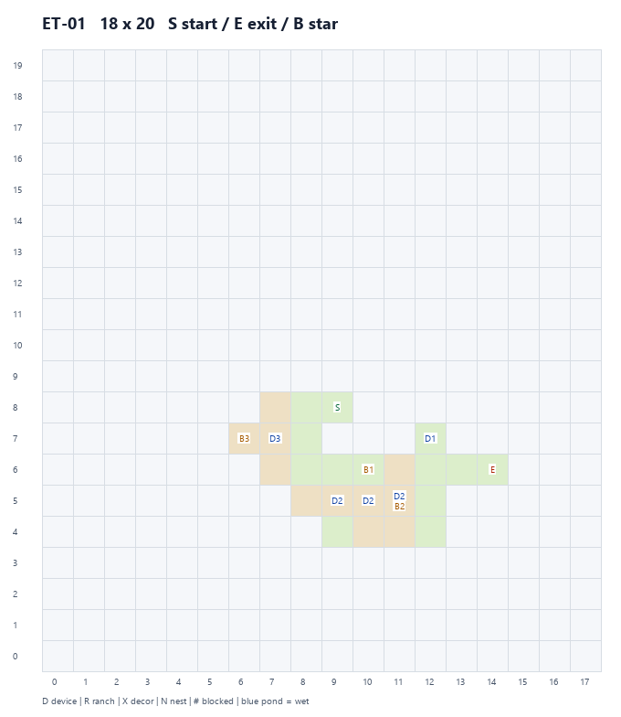

| 표시 | 장치 ID | 종류 | 기준 좌표 | 초기 점유 칸 | 방향과 연결 설정 |
|---|---|---|---|---|---|
| D1 | bookshelf_3 | 책장 압력판 | (12,7) | (12,7) | 변형 plate; 연결 그룹 link_d7184b95 |
| D2 | bookshelf_5 | 책장 | (10,5) | (9,5), (10,5), (11,5) | 연결 그룹 link_d7184b95 |
| D3 | cowarddoll_1 | 겁쟁이 인형 | (7,7) | (7,7) | 방향 → |

| 책장 ID | 회전 방향 | 초기 회전 영역 |
|---|---|---|
| bookshelf_5 | 시계 | (10,5), (9,5), (11,5), (10,6), (10,4), (11,4), (9,6) |

추가 장치 목표(goals)는 없으며, 별 수집 목표와 출구가 승리 조건이다.

원본 시나리오 costLimit: 0 (제한 없음). 실제 HUD 예산에 적용되는 별도 기록과 구분한다.

### ET-02

시나리오 제목: **굴림과 반사의 모퉁이**. 화면 연결: **ET-07**. [원본 에셋](../Assets/ANIMOL/Data/Puzzle/MapData/memory_theater/ET-02_MapData.asset).

격자 18×20, 바닥 29칸(극장 무대 바닥 29), 막힌 지형 0칸, 지형 없는 칸 331칸이다. 정적 바닥은 1개 영역으로 나뉜다.

시작 (1,2), 출구 (6,7). 별은 (1,5), (1,3), (7,3)에 있으며 수집 목표는 3개다.

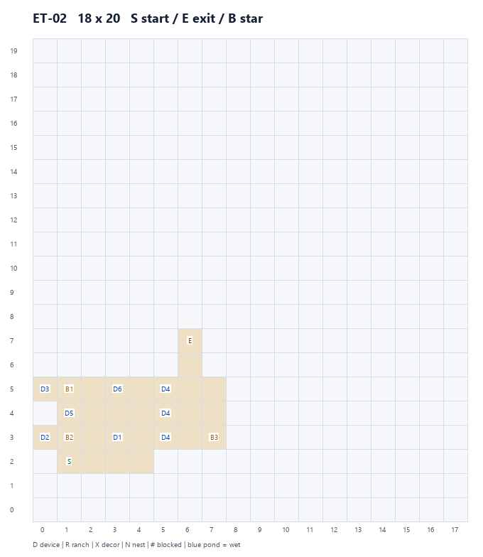

| 표시 | 장치 ID | 종류 | 기준 좌표 | 초기 점유 칸 | 방향과 연결 설정 |
|---|---|---|---|---|---|
| D1 | glass_2 | 유리벽 | (3,3) | (3,3) | 변형 square |
| D2 | statue_1 | 돌진 석상 | (0,3) | (0,3) | 방향 →; 기본 돌진 범위 6 |
| D3 | statue_2 | 돌진 석상 | (0,5) | (0,5) | 방향 →; 기본 돌진 범위 6 |
| D4 | bookshelf_1 | 책장 | (5,4) | (5,3), (5,4), (5,5) | 연결 그룹 link_1febd822 |
| D5 | bookshelf_2 | 책장 압력판 | (1,4) | (1,4) | 변형 plate; 연결 그룹 link_1febd822 |
| D6 | dice_1 | 주사위 | (3,5) | (3,5) | 면 [위,아래,북,남,동,서]=1,6,5,2,3,4 |

| 책장 ID | 회전 방향 | 초기 회전 영역 |
|---|---|---|
| bookshelf_1 | 시계 | (5,4), (4,4), (6,4), (5,5), (5,3), (6,5), (4,3) |

추가 장치 목표(goals)는 없으며, 별 수집 목표와 출구가 승리 조건이다.

원본 시나리오 costLimit: 0 (제한 없음). 실제 HUD 예산에 적용되는 별도 기록과 구분한다.

### ET-03

시나리오 제목: **옆에서 접는 가림벽**. 화면 연결: **ET-03**. [원본 에셋](../Assets/ANIMOL/Data/Puzzle/MapData/memory_theater/ET-03_MapData.asset).

격자 18×20, 바닥 38칸(풀 4, 극장 무대 바닥 34), 막힌 지형 0칸, 지형 없는 칸 322칸이다. 정적 바닥은 1개 영역으로 나뉜다.

시작 (0,4), 출구 (6,8). 별은 (2,8), (4,6)에 있으며 수집 목표는 2개다.

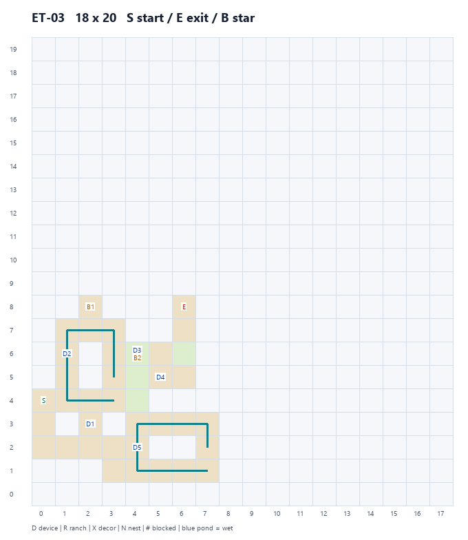

| 표시 | 장치 ID | 종류 | 기준 좌표 | 초기 점유 칸 | 방향과 연결 설정 |
|---|---|---|---|---|---|
| D1 | dice_1 | 주사위 | (2,3) | (2,3) | 면 [위,아래,북,남,동,서]=1,6,5,2,3,4 |
| D2 | movingstage_1 | 이동 발판 | (1,6) | (1,6) | 방향 ↓ |
| D3 | glass_1 | 유리벽 | (4,6) | (4,6) | 변형 square |
| D4 | dice_2 | 주사위 목표 | (5,5) | (5,5) | 변형 target; 목표 윗면 3; 진입 방향 → |
| D5 | movingstage_3 | 이동 발판 | (4,2) | (4,2) | 방향 ↓ |

| 레일 ID | 저장된 경로 순서 |
|---|---|
| rail_3 | (3,5), (3,6), (3,7), (2,7), (1,7), (1,6), (1,5), (1,4), (2,4), (3,4) |
| rail_1 | (7,2), (7,3), (6,3), (5,3), (4,3), (4,2), (4,1), (5,1), (6,1), (7,1) |

추가 장치 목표(goals)는 없으며, 별 수집 목표와 출구가 승리 조건이다.

원본 시나리오 costLimit: 0 (제한 없음). 실제 HUD 예산에 적용되는 별도 기록과 구분한다.

### ET-04

시나리오 제목: **책장 뒤 첫 방울**. 화면 연결: **ET-04**. [원본 에셋](../Assets/ANIMOL/Data/Puzzle/MapData/memory_theater/ET-04_MapData.asset).

격자 18×20, 바닥 33칸(풀 3, 극장 무대 바닥 30), 막힌 지형 0칸, 지형 없는 칸 327칸이다. 정적 바닥은 1개 영역으로 나뉜다.

시작 (3,2), 출구 (8,9). 별은 (4,9), (2,6)에 있으며 수집 목표는 2개다.

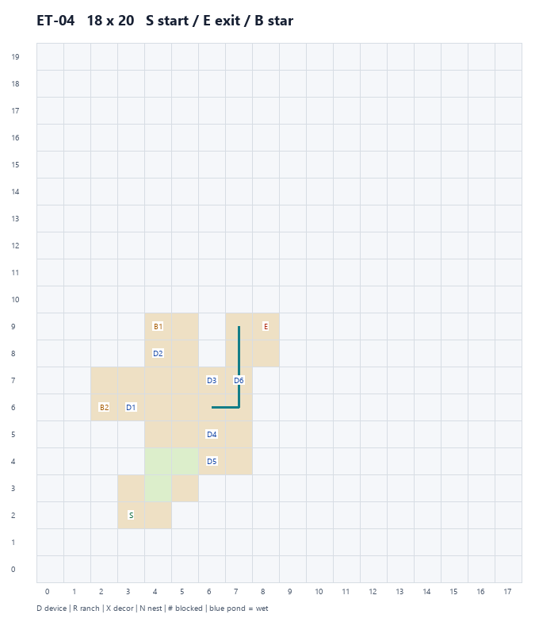

| 표시 | 장치 ID | 종류 | 기준 좌표 | 초기 점유 칸 | 방향과 연결 설정 |
|---|---|---|---|---|---|
| D1 | cowarddoll_1 | 겁쟁이 인형 | (3,6) | (3,6) | 방향 → |
| D2 | cowarddoll_2 | 겁쟁이 인형 | (4,8) | (4,8) | 방향 → |
| D3 | cowarddoll_4 | 겁쟁이 인형 | (6,7) | (6,7) | 방향 → |
| D4 | dice_2 | 주사위 | (6,5) | (6,5) | 면 [위,아래,북,남,동,서]=1,6,5,2,3,4 |
| D5 | dice_1 | 주사위 | (6,4) | (6,4) | 면 [위,아래,북,남,동,서]=1,6,5,2,3,4 |
| D6 | movingstage_1 | 이동 발판 | (7,7) | (7,7) | 방향 ↑ |

| 레일 ID | 저장된 경로 순서 |
|---|---|
| rail_1 | (6,6), (7,6), (7,7), (7,8), (7,9) |

추가 장치 목표(goals)는 없으며, 별 수집 목표와 출구가 승리 조건이다.

원본 시나리오 costLimit: 0 (제한 없음). 실제 HUD 예산에 적용되는 별도 기록과 구분한다.

### ET-05

시나리오 제목: **숫자를 돌리는 첫 길**. 화면 연결: **ET-05**. [원본 에셋](../Assets/ANIMOL/Data/Puzzle/MapData/memory_theater/ET-05_MapData.asset).

격자 18×20, 바닥 42칸(풀 10, 극장 무대 바닥 32), 막힌 지형 0칸, 지형 없는 칸 318칸이다. 정적 바닥은 1개 영역으로 나뉜다.

시작 (7,5), 출구 (12,10). 별은 (8,8), (10,11)에 있으며 수집 목표는 2개다.

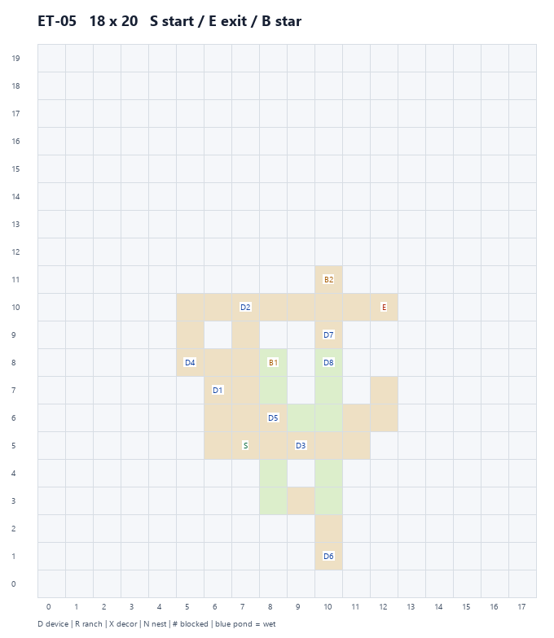

| 표시 | 장치 ID | 종류 | 기준 좌표 | 초기 점유 칸 | 방향과 연결 설정 |
|---|---|---|---|---|---|
| D1 | statue_1 | 돌진 석상 | (6,7) | (6,7) | 방향 →; 기본 돌진 범위 6 |
| D2 | statue_4 | 돌진 석상 | (7,10) | (7,10) | 방향 ↓; 기본 돌진 범위 6 |
| D3 | glass_1 | 유리벽 | (9,5) | (9,5) | 변형 square |
| D4 | statue_5 | 돌진 석상 | (5,8) | (5,8) | 방향 →; 기본 돌진 범위 6 |
| D5 | glass_2 | 유리벽 | (8,6) | (8,6) | 변형 square |
| D6 | statue_2 | 돌진 석상 | (10,1) | (10,1) | 방향 ↑; 기본 돌진 범위 6 |
| D7 | domino_1 | 도미노 | (10,9) | (10,9) | 방향 ↑ |
| D8 | domino_2 | 도미노 | (10,8) | (10,8) | 방향 ↑ |

추가 장치 목표(goals)는 없으며, 별 수집 목표와 출구가 승리 조건이다.

원본 시나리오 costLimit: 0 (제한 없음). 실제 HUD 예산에 적용되는 별도 기록과 구분한다.

### ET-06

ET-06 파일과 메타의 삭제 상태를 유지했다. 현재 실제 화면 연결은 ET-06→원본 ET-01이며, 삭제된 파일을 복원하지 않았다.

### ET-07

시나리오 제목: **개막 전 셔터**. 화면 연결: **ET-01**. [원본 에셋](../Assets/ANIMOL/Data/Puzzle/MapData/memory_theater/ET-07_MapData.asset).

격자 18×20, 바닥 40칸(풀 40), 막힌 지형 0칸, 지형 없는 칸 320칸이다. 정적 바닥은 1개 영역으로 나뉜다.

시작 (9,9), 출구 (12,11). 별은 (9,11), (13,7)에 있으며 수집 목표는 2개다.

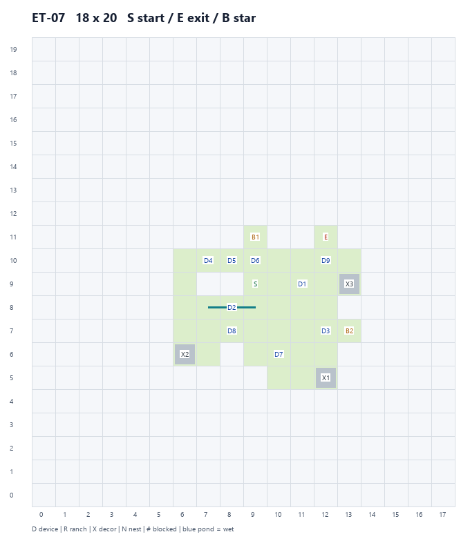

| 표시 | 장치 ID | 종류 | 기준 좌표 | 초기 점유 칸 | 방향과 연결 설정 |
|---|---|---|---|---|---|
| D1 | dice_1 | 주사위 | (11,9) | (11,9) | 면 [위,아래,북,남,동,서]=1,6,5,2,3,4 |
| D2 | movingstage_1 | 이동 발판 | (8,8) | (8,8) | 방향 → |
| D3 | dice_2 | 주사위 목표 | (12,7) | (12,7) | 변형 target; 목표 윗면 1; 진입 방향 → |
| D4 | domino_1 | 도미노 | (7,10) | (7,10) | 방향 → |
| D5 | domino_2 | 도미노 | (8,10) | (8,10) | 방향 → |
| D6 | domino_3 | 도미노 | (9,10) | (9,10) | 방향 → |
| D7 | dice_3 | 주사위 | (10,6) | (10,6) | 면 [위,아래,북,남,동,서]=1,6,5,2,3,4 |
| D8 | shutter_1 | 셔터 | (8,7) | (8,7) | 초기 닫힘 |
| D9 | glass_1 | 유리벽 | (12,10) | (12,10) | 변형 square |

| 레일 ID | 저장된 경로 순서 |
|---|---|
| rail_1 | (7,8), (8,8), (9,8) |

| 표시 | 장식 종류 또는 스프라이트 | 기준 좌표 | 실제 점유 칸 |
|---|---|---|---|
| X1 | script_pile | (12,5) | (12,5) |
| X2 | mask_pedestal | (6,6) | (6,6) |
| X3 | music_stand | (13,9) | (13,9) |

추가 장치 목표(goals)는 없으며, 별 수집 목표와 출구가 승리 조건이다.

원본 시나리오 costLimit: 0 (제한 없음). 실제 HUD 예산에 적용되는 별도 기록과 구분한다.

### ET-08

시나리오 제목: **물러서는 주연**. 화면 연결: **ET-08**. [원본 에셋](../Assets/ANIMOL/Data/Puzzle/MapData/memory_theater/ET-08_MapData.asset).

격자 18×20, 바닥 33칸(풀 4, 극장 무대 바닥 29), 막힌 지형 0칸, 지형 없는 칸 327칸이다. 정적 바닥은 1개 영역으로 나뉜다.

시작 (4,2), 출구 (9,9). 별은 (2,6), (3,8)에 있으며 수집 목표는 2개다.

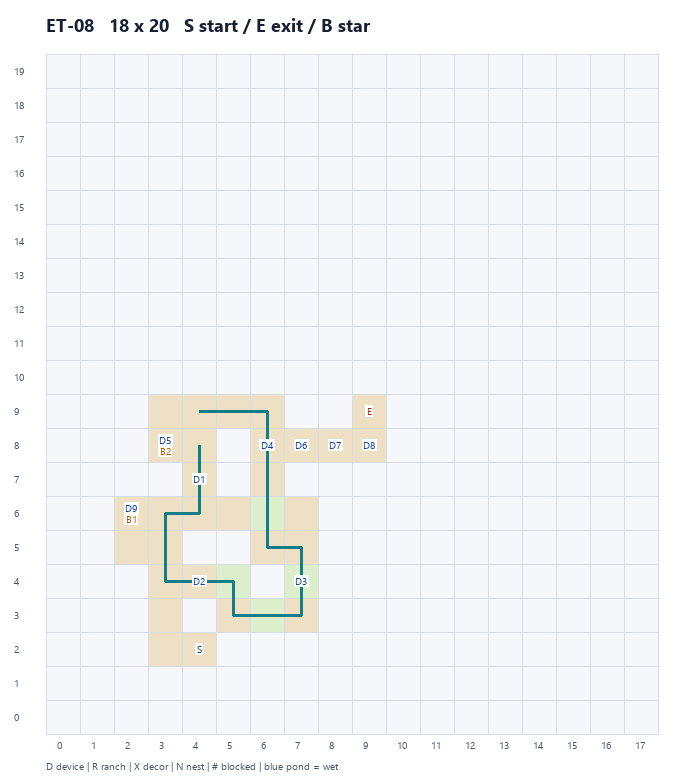

| 표시 | 장치 ID | 종류 | 기준 좌표 | 초기 점유 칸 | 방향과 연결 설정 |
|---|---|---|---|---|---|
| D1 | movingstage_1 | 이동 발판 | (4,7) | (4,7) | 방향 ↓ |
| D2 | movingstage_2 | 이동 발판 | (4,4) | (4,4) | 방향 → |
| D3 | movingstage_3 | 이동 발판 | (7,4) | (7,4) | 방향 ↑ |
| D4 | movingstage_4 | 이동 발판 | (6,8) | (6,8) | 방향 ↑ |
| D5 | shutter_1 | 셔터 | (3,8) | (3,8) | 초기 닫힘 |
| D6 | domino_1 | 도미노 | (7,8) | (7,8) | 방향 → |
| D7 | domino_2 | 도미노 | (8,8) | (8,8) | 방향 → |
| D8 | domino_3 | 도미노 | (9,8) | (9,8) | 방향 → |
| D9 | shutter_2 | 셔터 | (2,6) | (2,6) | 초기 열림; 초기 active=true |

| 레일 ID | 저장된 경로 순서 |
|---|---|
| rail_1 | (4,8), (4,7), (4,6), (3,6), (3,5), (3,4), (4,4), (5,4), (5,3), (6,3), (7,3), (7,4), (7,5), (6,5), (6,6), (6,7), (6,8), (6,9), (5,9), (4,9) |

추가 장치 목표(goals)는 없으며, 별 수집 목표와 출구가 승리 조건이다.

원본 시나리오 costLimit: 0 (제한 없음). 실제 HUD 예산에 적용되는 별도 기록과 구분한다.

### ET-09

시나리오 제목: **접힌 벽 너머 주사위**. 화면 연결: **ET-09**. [원본 에셋](../Assets/ANIMOL/Data/Puzzle/MapData/memory_theater/ET-09_MapData.asset).

격자 18×20, 바닥 38칸(풀 2, 극장 무대 바닥 36), 막힌 지형 0칸, 지형 없는 칸 322칸이다. 정적 바닥은 1개 영역으로 나뉜다.

시작 (5,5), 출구 (9,9). 별은 (3,7), (3,3), (7,3)에 있으며 수집 목표는 3개다.

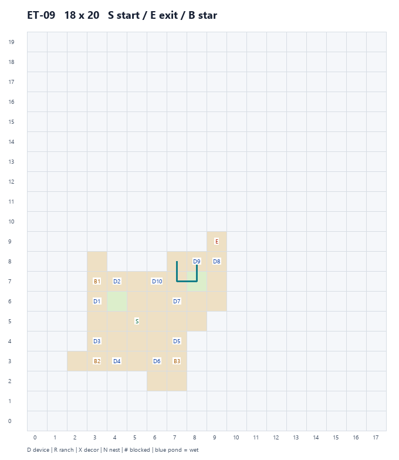

| 표시 | 장치 ID | 종류 | 기준 좌표 | 초기 점유 칸 | 방향과 연결 설정 |
|---|---|---|---|---|---|
| D1 | cowarddoll_3 | 겁쟁이 인형 | (3,6) | (3,6) | 방향 → |
| D2 | cowarddoll_4 | 겁쟁이 인형 | (4,7) | (4,7) | 방향 → |
| D3 | cowarddoll_1 | 겁쟁이 인형 | (3,4) | (3,4) | 방향 → |
| D4 | cowarddoll_7 | 겁쟁이 인형 | (4,3) | (4,3) | 방향 → |
| D5 | cowarddoll_2 | 겁쟁이 인형 | (7,4) | (7,4) | 방향 → |
| D6 | cowarddoll_8 | 겁쟁이 인형 | (6,3) | (6,3) | 방향 → |
| D7 | dice_1 | 주사위 | (7,6) | (7,6) | 면 [위,아래,북,남,동,서]=1,6,5,2,3,4 |
| D8 | dice_3 | 주사위 목표 | (9,8) | (9,8) | 변형 target; 목표 윗면 6; 진입 방향 → |
| D9 | movingstage_1 | 이동 발판 | (8,8) | (8,8) | 방향 ↓ |
| D10 | dice_2 | 주사위 | (6,7) | (6,7) | 면 [위,아래,북,남,동,서]=1,6,5,2,3,4 |

| 레일 ID | 저장된 경로 순서 |
|---|---|
| rail_2 | (7,8), (7,7), (8,7), (8,8) |

추가 장치 목표(goals)는 없으며, 별 수집 목표와 출구가 승리 조건이다.

원본 시나리오 costLimit: 0 (제한 없음). 실제 HUD 예산에 적용되는 별도 기록과 구분한다.

### ET-10

시나리오 제목: **교차 골목의 주사위**. 화면 연결: **ET-10**. [원본 에셋](../Assets/ANIMOL/Data/Puzzle/MapData/memory_theater/ET-10_MapData.asset).

격자 18×20, 바닥 39칸(극장 무대 바닥 39), 막힌 지형 0칸, 지형 없는 칸 321칸이다. 정적 바닥은 1개 영역으로 나뉜다.

시작 (1,2), 출구 (5,8). 별은 (2,6), (6,3)에 있으며 수집 목표는 2개다.

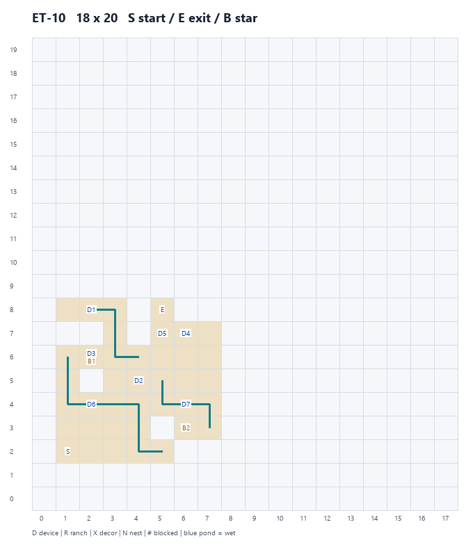

| 표시 | 장치 ID | 종류 | 기준 좌표 | 초기 점유 칸 | 방향과 연결 설정 |
|---|---|---|---|---|---|
| D1 | movingstage_3 | 이동 발판 | (2,8) | (2,8) | 방향 → |
| D2 | dice_1 | 주사위 | (4,5) | (4,5) | 면 [위,아래,북,남,동,서]=1,6,5,2,3,4 |
| D3 | shutter_1 | 셔터 | (2,6) | (2,6) | 초기 닫힘 |
| D4 | statue_1 | 돌진 석상 | (6,7) | (6,7) | 방향 ↓; 기본 돌진 범위 6 |
| D5 | dice_2 | 주사위 목표 | (5,7) | (5,7) | 변형 target; 목표 윗면 4; 진입 방향 → |
| D6 | movingstage_2 | 이동 발판 | (2,4) | (2,4) | 방향 → |
| D7 | movingstage_1 | 이동 발판 | (6,4) | (6,4) | 방향 → |

| 레일 ID | 저장된 경로 순서 |
|---|---|
| rail_1 | (5,5), (5,4), (6,4), (7,4), (7,3) |
| rail_3 | (1,6), (1,5), (1,4), (2,4), (3,4), (4,4), (4,3), (4,2), (5,2) |
| rail_2 | (4,6), (3,6), (3,7), (3,8), (2,8) |

추가 장치 목표(goals)는 없으며, 별 수집 목표와 출구가 승리 조건이다.

원본 시나리오 costLimit: 0 (제한 없음). 실제 HUD 예산에 적용되는 별도 기록과 구분한다.

### ET-11

시나리오 제목: **책장과 주사위 길**. 화면 연결: **ET-11**. [원본 에셋](../Assets/ANIMOL/Data/Puzzle/MapData/memory_theater/ET-11_MapData.asset).

격자 18×20, 바닥 44칸(극장 무대 바닥 44), 막힌 지형 0칸, 지형 없는 칸 316칸이다. 정적 바닥은 1개 영역으로 나뉜다.

시작 (6,2), 출구 (9,10). 별은 (4,7), (5,9), (8,9)에 있으며 수집 목표는 3개다.

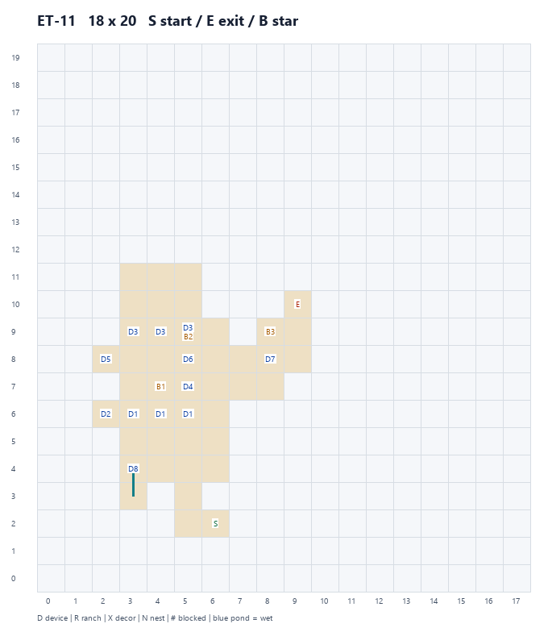

| 표시 | 장치 ID | 종류 | 기준 좌표 | 초기 점유 칸 | 방향과 연결 설정 |
|---|---|---|---|---|---|
| D1 | bookshelf_2 | 책장 | (4,6) | (3,6), (4,6), (5,6) | 연결 그룹 link_611aef98 |
| D2 | bookshelf_3 | 책장 압력판 | (2,6) | (2,6) | 변형 plate; 연결 그룹 link_ba69f63d |
| D3 | bookshelf_4 | 책장 | (4,9) | (3,9), (4,9), (5,9) | 연결 그룹 link_ba69f63d |
| D4 | cowarddoll_1 | 겁쟁이 인형 | (5,7) | (5,7) | 방향 → |
| D5 | bookshelf_5 | 책장 압력판 | (2,8) | (2,8) | 변형 plate; 연결 그룹 link_611aef98 |
| D6 | cowarddoll_2 | 겁쟁이 인형 | (5,8) | (5,8) | 방향 → |
| D7 | cowarddoll_3 | 겁쟁이 인형 | (8,8) | (8,8) | 방향 → |
| D8 | movingstage_1 | 이동 발판 | (3,4) | (3,4) | 방향 ↓ |

| 책장 ID | 회전 방향 | 초기 회전 영역 |
|---|---|---|
| bookshelf_2 | 반시계 | (4,6), (3,6), (5,6), (4,7), (4,5), (5,7), (3,5) |
| bookshelf_4 | 반시계 | (4,9), (3,9), (5,9), (4,10), (4,8), (5,10), (3,8) |

| 레일 ID | 저장된 경로 순서 |
|---|---|
| rail_1 | (3,4), (3,3) |

추가 장치 목표(goals)는 없으며, 별 수집 목표와 출구가 승리 조건이다.

원본 시나리오 costLimit: 0 (제한 없음). 실제 HUD 예산에 적용되는 별도 기록과 구분한다.

### SW00

시나리오 제목: **다섯 섬의 이중 수문**. 화면 연결: **SW01**. [원본 에셋](../Assets/ANIMOL/Data/Puzzle/MapData/starway/SW00_MapData.asset).

격자 18×22, 바닥 48칸(풀 48), 막힌 지형 12칸, 지형 없는 칸 336칸이다. 정적 바닥은 2개 영역으로 나뉜다.

시작 (1,6), 출구 (16,6). 별은 (2,8), (8,9), (12,8)에 있으며 수집 목표는 3개다.

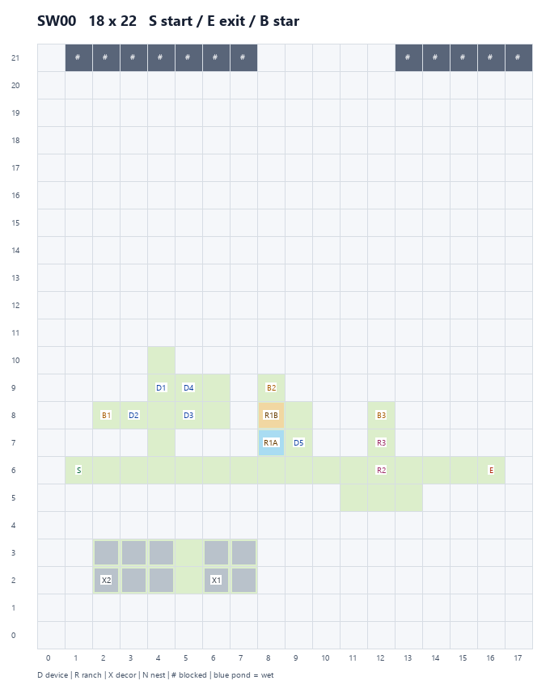

| 표시 | 장치 ID | 종류 | 기준 좌표 | 초기 점유 칸 | 방향과 연결 설정 |
|---|---|---|---|---|---|
| D1 | metalcrate_2 | 금속 상자 | (4,9) | (4,9) | 기본값 |
| D2 | starsocket_2 | 별 홈 | (3,8) | (3,8) | 변형 socket; 번호 1 |
| D3 | starsocket_1 | 별돌 | (5,8) | (5,8) | 번호 1 |
| D4 | onewaygate_1 | 일방통행 문 | (5,9) | (5,9) | 방향 → |
| D5 | onewaygate_2 | 일방통행 문 | (9,7) | (9,7) | 방향 ↑ |

| 표시 | 목장 기믹 | 기준 좌표 | 세부 배치 |
|---|---|---|---|
| R1 | 수문 | (8,7) | A (8,7) ↔ B (8,8); 초기 물 (8,7) |
| R2 | 양 | (12,6) | 초기 방향 → |
| R3 | 키 큰 풀 | (12,7) | 양과의 상호작용 대상인 풀 칸 |

| 표시 | 장식 종류 또는 스프라이트 | 기준 좌표 | 실제 점유 칸 |
|---|---|---|---|
| X1 | apiary_corner_2x2 | (6,2) | (6,2), (7,2), (6,3), (7,3) |
| X2 | produce_stall_3x2 | (2,2) | (2,2), (3,2), (4,2), (2,3), (3,3), (4,3) |

추가 장치 목표(goals)는 없으며, 별 수집 목표와 출구가 승리 조건이다.

원본 시나리오 costLimit: 0 (제한 없음). 실제 HUD 예산에 적용되는 별도 기록과 구분한다.

### SW01

시나리오 제목: **1-1**. 화면 연결: **SW02**. [원본 에셋](../Assets/ANIMOL/Data/Puzzle/MapData/starway/SW01_MapData.asset).

격자 12×20, 바닥 91칸(풀 90, 돌 1), 막힌 지형 0칸, 지형 없는 칸 149칸이다. 정적 바닥은 1개 영역으로 나뉜다.

시작 (2,3), 출구 (10,16). 별은 (6,9), (10,5), (1,14)에 있으며 수집 목표는 3개다.

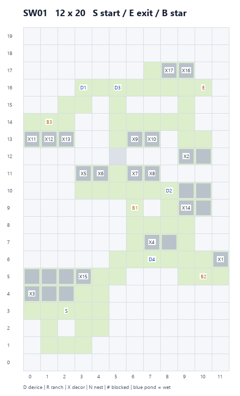

| 표시 | 장치 ID | 종류 | 기준 좌표 | 초기 점유 칸 | 방향과 연결 설정 |
|---|---|---|---|---|---|
| D1 | starsocket_2 | 별 홈 | (3,16) | (3,16) | 변형 socket; 번호 1 |
| D2 | chick_1 | 병아리 | (8,10) | (8,10) | 방향 →; 추적 지연 1 |
| D3 | starsocket_1 | 별돌 | (5,16) | (5,16) | 번호 1 |
| D4 | onewaygate_1 | 일방통행 문 | (7,6) | (7,6) | 방향 → |

| 표시 | 장식 종류 또는 스프라이트 | 기준 좌표 | 실제 점유 칸 |
|---|---|---|---|
| X1 | ranch_notice_sign | (11,6) | (11,6) |
| X2 | windmill_body.png | (9,12) | (9,12), (10,12) |
| X3 | picnic_arbor_3x2 | (0,4) | (0,4), (1,4), (2,4), (0,5), (1,5), (2,5) |
| X4 | garden_workbench_2x1 | (7,7) | (7,7), (8,7) |
| X5 | cream_fence | (3,11) | (3,11) |
| X6 | cream_fence | (4,11) | (4,11) |
| X7 | cream_fence | (6,11) | (6,11) |
| X8 | cream_fence | (7,11) | (7,11) |
| X9 | cream_fence | (6,13) | (6,13) |
| X10 | cream_fence | (7,13) | (7,13) |
| X11 | cream_fence | (0,13) | (0,13) |
| X12 | cream_fence | (1,13) | (1,13) |
| X13 | cream_fence | (2,13) | (2,13) |
| X14 | chicken_coop_2x2 | (9,9) | (9,9), (10,9), (9,10), (10,10) |
| X15 | milk_can_pair | (3,5) | (3,5) |
| X16 | watering_can | (9,17) | (9,17) |
| X17 | herb_planter_strip | (8,17) | (8,17) |

추가 장치 목표(goals)는 없으며, 별 수집 목표와 출구가 승리 조건이다.

원본 시나리오 costLimit: 54.

### SW02

시나리오 제목: **초승달의 첫 귀환**. 화면 연결: **SW03**. [원본 에셋](../Assets/ANIMOL/Data/Puzzle/MapData/starway/SW02_MapData.asset).

격자 18×20, 바닥 47칸(풀 47), 막힌 지형 10칸, 지형 없는 칸 303칸이다. 정적 바닥은 1개 영역으로 나뉜다.

시작 (2,12), 출구 (11,14). 별은 (4,10), (4,15)에 있으며 수집 목표는 2개다.

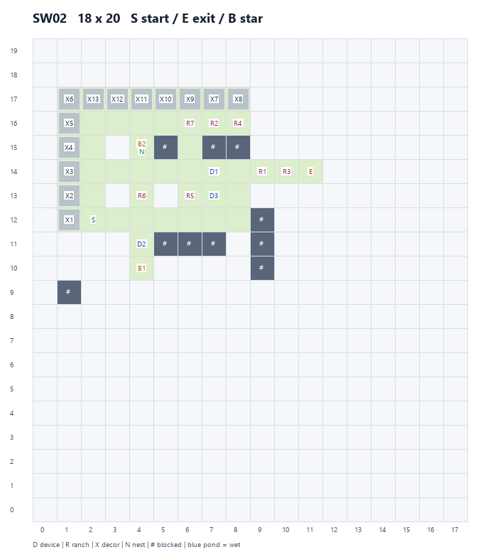

| 표시 | 장치 ID | 종류 | 기준 좌표 | 초기 점유 칸 | 방향과 연결 설정 |
|---|---|---|---|---|---|
| D1 | metalcrate_1 | 금속 상자 | (7,14) | (7,14) | 기본값 |
| D2 | chick_2 | 병아리 | (4,11) | (4,11) | 방향 →; 추적 지연 1 |
| D3 | metalcrate_2 | 금속 상자 | (7,13) | (7,13) | 기본값 |

| 표시 | 목장 기믹 | 기준 좌표 | 세부 배치 |
|---|---|---|---|
| R1 | 키 큰 풀 | (9,14) | 양과의 상호작용 대상인 풀 칸 |
| R2 | 키 큰 풀 | (7,16) | 양과의 상호작용 대상인 풀 칸 |
| R3 | 키 큰 풀 | (10,14) | 양과의 상호작용 대상인 풀 칸 |
| R4 | 키 큰 풀 | (8,16) | 양과의 상호작용 대상인 풀 칸 |
| R5 | 양 | (6,13) | 초기 방향 → |
| R6 | 양 | (4,13) | 초기 방향 → |
| R7 | 양 | (6,16) | 초기 방향 → |

둥지: (4,15).

| 표시 | 장식 종류 또는 스프라이트 | 기준 좌표 | 실제 점유 칸 |
|---|---|---|---|
| X1 | raised_flower_meadow | (1,12) | (1,12) |
| X2 | raised_flower_meadow | (1,13) | (1,13) |
| X3 | raised_flower_meadow | (1,14) | (1,14) |
| X4 | raised_flower_meadow | (1,15) | (1,15) |
| X5 | raised_flower_meadow | (1,16) | (1,16) |
| X6 | raised_flower_meadow | (1,17) | (1,17) |
| X7 | raised_flower_meadow | (7,17) | (7,17) |
| X8 | raised_flower_meadow | (8,17) | (8,17) |
| X9 | raised_flower_meadow | (6,17) | (6,17) |
| X10 | raised_flower_meadow | (5,17) | (5,17) |
| X11 | raised_flower_meadow | (4,17) | (4,17) |
| X12 | raised_flower_meadow | (3,17) | (3,17) |
| X13 | raised_flower_meadow | (2,17) | (2,17) |

추가 장치 목표(goals)는 없으며, 별 수집 목표와 출구가 승리 조건이다.

원본 시나리오 costLimit: 0 (제한 없음). 실제 HUD 예산에 적용되는 별도 기록과 구분한다.

### SW03

시나리오 제목: **모래시계의 두 입구**. 화면 연결: **SW04**. [원본 에셋](../Assets/ANIMOL/Data/Puzzle/MapData/starway/SW03_MapData.asset).

격자 18×20, 바닥 124칸(풀 124), 막힌 지형 126칸, 지형 없는 칸 110칸이다. 정적 바닥은 1개 영역으로 나뉜다.

시작 (7,12), 출구 (12,12). 별은 (14,6), (6,14), (12,8)에 있으며 수집 목표는 2개다.

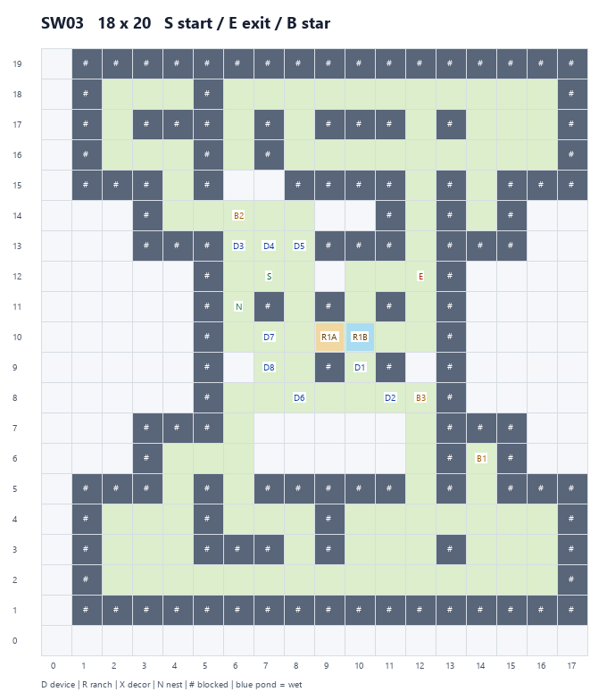

| 표시 | 장치 ID | 종류 | 기준 좌표 | 초기 점유 칸 | 방향과 연결 설정 |
|---|---|---|---|---|---|
| D1 | starsocket_3 | 별돌 | (10,9) | (10,9) | 번호 1 |
| D2 | starsocket_2 | 별 홈 | (11,8) | (11,8) | 변형 socket; 번호 1 |
| D3 | metalcrate_2 | 금속 상자 | (6,13) | (6,13) | 기본값 |
| D4 | metalcrate_3 | 금속 상자 | (7,13) | (7,13) | 기본값 |
| D5 | metalcrate_4 | 금속 상자 | (8,13) | (8,13) | 기본값 |
| D6 | chick_1 | 병아리 | (8,8) | (8,8) | 방향 →; 추적 지연 1; 둥지 (6,11) |
| D7 | metalcrate_5 | 금속 상자 | (7,10) | (7,10) | 기본값 |
| D8 | metalcrate_6 | 금속 상자 | (7,9) | (7,9) | 기본값 |

| 표시 | 목장 기믹 | 기준 좌표 | 세부 배치 |
|---|---|---|---|
| R1 | 수문 | (9,10) | A (9,10) ↔ B (10,10); 초기 물 (10,10) |

둥지: (6,11).

추가 장치 목표(goals)는 없으며, 별 수집 목표와 출구가 승리 조건이다.

원본 시나리오 costLimit: 0 (제한 없음). 실제 HUD 예산에 적용되는 별도 기록과 구분한다.

### SW04

시나리오 제목: **고리 안쪽의 풀밭**. 화면 연결: **SW05**. [원본 에셋](../Assets/ANIMOL/Data/Puzzle/MapData/starway/SW04_MapData.asset).

격자 18×20, 바닥 137칸(풀 137), 막힌 지형 130칸, 지형 없는 칸 93칸이다. 정적 바닥은 2개 영역으로 나뉜다.

시작 (5,10), 출구 (13,10). 별은 (12,8), (12,12), (9,7)에 있으며 수집 목표는 3개다.

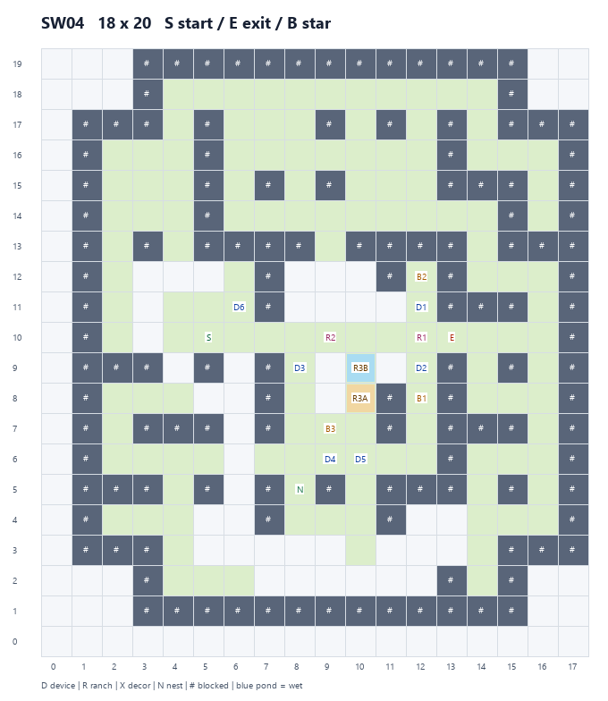

| 표시 | 장치 ID | 종류 | 기준 좌표 | 초기 점유 칸 | 방향과 연결 설정 |
|---|---|---|---|---|---|
| D1 | starsocket_1 | 별 홈 | (12,11) | (12,11) | 변형 socket; 번호 1 |
| D2 | starsocket_2 | 별돌 | (12,9) | (12,9) | 번호 1 |
| D3 | metalcrate_1 | 금속 상자 | (8,9) | (8,9) | 기본값 |
| D4 | metalcrate_2 | 금속 상자 | (9,6) | (9,6) | 기본값 |
| D5 | metalcrate_3 | 금속 상자 | (10,6) | (10,6) | 기본값 |
| D6 | chick_1 | 병아리 | (6,11) | (6,11) | 방향 →; 추적 지연 1; 둥지 (8,5) |

| 표시 | 목장 기믹 | 기준 좌표 | 세부 배치 |
|---|---|---|---|
| R1 | 키 큰 풀 | (12,10) | 양과의 상호작용 대상인 풀 칸 |
| R2 | 양 | (9,10) | 초기 방향 → |
| R3 | 수문 | (10,8) | A (10,8) ↔ B (10,9); 초기 물 (10,9) |

둥지: (8,5).

추가 장치 목표(goals)는 없으며, 별 수집 목표와 출구가 승리 조건이다.

원본 시나리오 costLimit: 0 (제한 없음). 실제 HUD 예산에 적용되는 별도 기록과 구분한다.

### SW05

시나리오 제목: **네 갈래 방울 마당**. 화면 연결: **SW06**. [원본 에셋](../Assets/ANIMOL/Data/Puzzle/MapData/starway/SW05_MapData.asset).

격자 18×20, 바닥 33칸(풀 33), 막힌 지형 0칸, 지형 없는 칸 327칸이다. 정적 바닥은 1개 영역으로 나뉜다.

시작 (0,5), 출구 (11,11). 별은 (3,6), (6,10)에 있으며 수집 목표는 2개다.

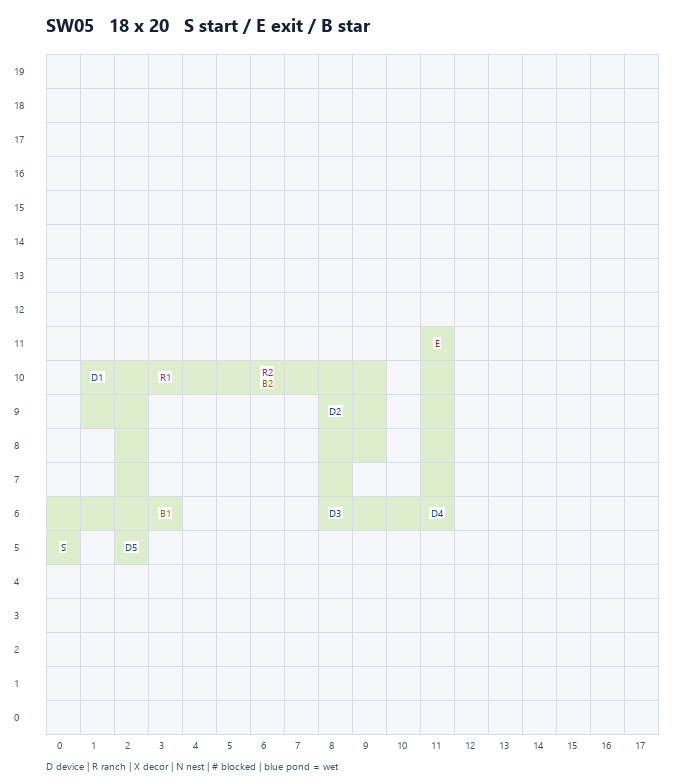

| 표시 | 장치 ID | 종류 | 기준 좌표 | 초기 점유 칸 | 방향과 연결 설정 |
|---|---|---|---|---|---|
| D1 | wind_1 | 바람 발생기 | (1,10) | (1,10) | 방향 →; 변형 blower |
| D2 | wind_3 | 바람 발생기 | (8,9) | (8,9) | 방향 ↓; 변형 blower |
| D3 | bounce_1 | 반사판 | (8,6) | (8,6) | 회전값 3 |
| D4 | bounce_2 | 반사판 | (11,6) | (11,6) | 회전값 2 |
| D5 | wind_4 | 바람 발생기 | (2,5) | (2,5) | 방향 ↑; 변형 blower |

| 표시 | 목장 기믹 | 기준 좌표 | 세부 배치 |
|---|---|---|---|
| R1 | 양 | (3,10) | 초기 방향 → |
| R2 | 키 큰 풀 | (6,10) | 양과의 상호작용 대상인 풀 칸 |

추가 장치 목표(goals)는 없으며, 별 수집 목표와 출구가 승리 조건이다.

원본 시나리오 costLimit: 0 (제한 없음). 실제 HUD 예산에 적용되는 별도 기록과 구분한다.

### SW06

시나리오 제목: **계단 구름 수문**. 화면 연결: **SW07**. [원본 에셋](../Assets/ANIMOL/Data/Puzzle/MapData/starway/SW06_MapData.asset).

격자 18×20, 바닥 62칸(풀 62), 막힌 지형 87칸, 지형 없는 칸 211칸이다. 정적 바닥은 1개 영역으로 나뉜다.

시작 (4,2), 출구 (8,9). 별은 (8,3), (4,5)에 있으며 수집 목표는 2개다.

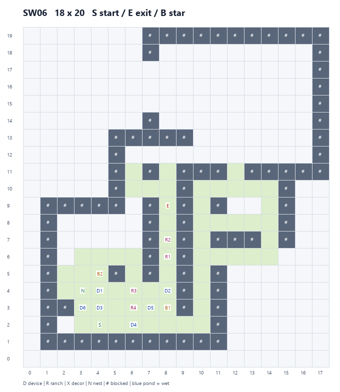

| 표시 | 장치 ID | 종류 | 기준 좌표 | 초기 점유 칸 | 방향과 연결 설정 |
|---|---|---|---|---|---|
| D1 | wind_1 | 바람 발생기 | (4,4) | (4,4) | 방향 →; 변형 blower |
| D2 | bounce_1 | 반사판 | (8,4) | (8,4) | 회전값 2 |
| D3 | chick_1 | 병아리 | (4,3) | (4,3) | 방향 →; 추적 지연 1; 둥지 (3,4) |
| D4 | metalcrate_1 | 금속 상자 | (6,2) | (6,2) | 기본값 |
| D5 | metalcrate_2 | 금속 상자 | (7,3) | (7,3) | 기본값 |
| D6 | onewaygate_1 | 일방통행 문 | (3,3) | (3,3) | 방향 ↓ |

| 표시 | 목장 기믹 | 기준 좌표 | 세부 배치 |
|---|---|---|---|
| R1 | 키 큰 풀 | (8,6) | 양과의 상호작용 대상인 풀 칸 |
| R2 | 키 큰 풀 | (8,7) | 양과의 상호작용 대상인 풀 칸 |
| R3 | 양 | (6,4) | 초기 방향 → |
| R4 | 양 | (6,3) | 초기 방향 → |

둥지: (3,4).

추가 장치 목표(goals)는 없으며, 별 수집 목표와 출구가 승리 조건이다.

원본 시나리오 costLimit: 0 (제한 없음). 실제 HUD 예산에 적용되는 별도 기록과 구분한다.

### SW07

시나리오 제목: **바람 끝의 제동 방울**. 화면 연결: **SW08**. [원본 에셋](../Assets/ANIMOL/Data/Puzzle/MapData/starway/SW07_MapData.asset).

격자 18×22, 바닥 50칸(풀 50), 막힌 지형 91칸, 지형 없는 칸 255칸이다. 정적 바닥은 2개 영역으로 나뉜다.

시작 (6,10), 출구 (8,3). 별은 (4,11), (4,5), (11,3)에 있으며 수집 목표는 3개다.

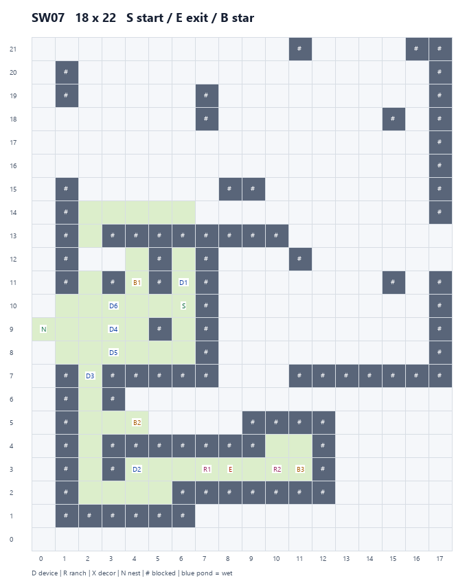

| 표시 | 장치 ID | 종류 | 기준 좌표 | 초기 점유 칸 | 방향과 연결 설정 |
|---|---|---|---|---|---|
| D1 | SW06_chick_1 | 병아리 | (6,11) | (6,11) | 방향 →; 추적 지연 1; 둥지 (0,9); 연결 그룹 SW06_chick_1 |
| D2 | SW06_wind_1 | 바람 발생기 | (4,3) | (4,3) | 방향 →; 변형 blower; 연결 그룹 SW06_wind_1 |
| D3 | starsocket_1 | 별 홈 | (2,7) | (2,7) | 변형 socket; 번호 1 |
| D4 | starsocket_2 | 별돌 | (3,9) | (3,9) | 번호 1 |
| D5 | metalcrate_1 | 금속 상자 | (3,8) | (3,8) | 기본값 |
| D6 | metalcrate_2 | 금속 상자 | (3,10) | (3,10) | 기본값 |

| 표시 | 목장 기믹 | 기준 좌표 | 세부 배치 |
|---|---|---|---|
| R1 | 양 | (7,3) | 초기 방향 → |
| R2 | 키 큰 풀 | (10,3) | 양과의 상호작용 대상인 풀 칸 |

둥지: (0,9).

추가 장치 목표(goals)는 없으며, 별 수집 목표와 출구가 승리 조건이다.

원본 시나리오 costLimit: 0 (제한 없음). 실제 HUD 예산에 적용되는 별도 기록과 구분한다.

### SW08

시나리오 제목: **말굽 정원 돌아오기**. 화면 연결: **SW09**. [원본 에셋](../Assets/ANIMOL/Data/Puzzle/MapData/starway/SW08_MapData.asset).

격자 18×20, 바닥 64칸(풀 64), 막힌 지형 78칸, 지형 없는 칸 218칸이다. 정적 바닥은 2개 영역으로 나뉜다.

시작 (4,5), 출구 (7,2). 별은 (2,5), (2,3)에 있으며 수집 목표는 2개다.

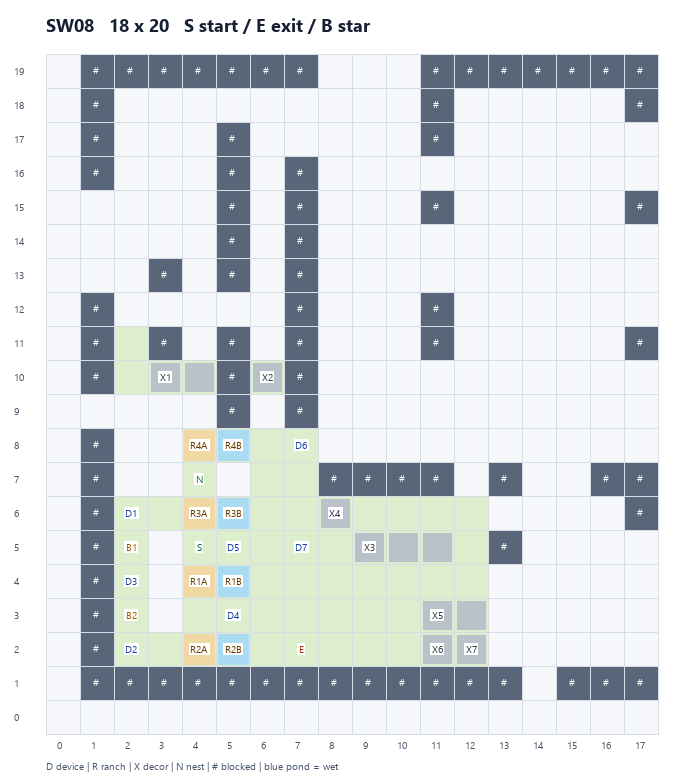

| 표시 | 장치 ID | 종류 | 기준 좌표 | 초기 점유 칸 | 방향과 연결 설정 |
|---|---|---|---|---|---|
| D1 | chick_1 | 병아리 | (2,6) | (2,6) | 방향 →; 추적 지연 1 |
| D2 | chick_3 | 병아리 | (2,2) | (2,2) | 방향 →; 추적 지연 1 |
| D3 | chick_2 | 병아리 | (2,4) | (2,4) | 방향 →; 추적 지연 1 |
| D4 | onewaygate_2 | 일방통행 문 | (5,3) | (5,3) | 방향 ← |
| D5 | onewaygate_1 | 일방통행 문 | (5,5) | (5,5) | 방향 ← |
| D6 | wind_1 | 바람 발생기 | (7,8) | (7,8) | 방향 ↓; 변형 blower |
| D7 | metalcrate_1 | 금속 상자 | (7,5) | (7,5) | 기본값 |

| 표시 | 목장 기믹 | 기준 좌표 | 세부 배치 |
|---|---|---|---|
| R1 | 수문 | (4,4) | A (4,4) ↔ B (5,4); 초기 물 (5,4) |
| R2 | 수문 | (4,2) | A (4,2) ↔ B (5,2); 초기 물 (5,2) |
| R3 | 수문 | (4,6) | A (4,6) ↔ B (5,6); 초기 물 (5,6) |
| R4 | 수문 | (4,8) | A (4,8) ↔ B (5,8); 초기 물 (5,8) |

둥지: (4,7).

| 표시 | 장식 종류 또는 스프라이트 | 기준 좌표 | 실제 점유 칸 |
|---|---|---|---|
| X1 | garden_workbench_2x1 | (3,10) | (3,10), (4,10) |
| X2 | watering_can | (6,10) | (6,10) |
| X3 | barnyard_3x2 | (9,5) | (9,5), (10,5), (11,5) |
| X4 | honey_jar_stand | (8,6) | (8,6) |
| X5 | windmill_body.png | (11,3) | (11,3), (12,3) |
| X6 | feed_sack_stack | (11,2) | (11,2) |
| X7 | feed_sack_stack | (12,2) | (12,2) |

추가 장치 목표(goals)는 없으며, 별 수집 목표와 출구가 승리 조건이다.

원본 시나리오 costLimit: 0 (제한 없음). 실제 HUD 예산에 적용되는 별도 기록과 구분한다.

### SW09

시나리오 제목: **굽이길의 선택 샛길**. 화면 연결: **SW10**. [원본 에셋](../Assets/ANIMOL/Data/Puzzle/MapData/starway/SW09_MapData.asset).

격자 18×20, 바닥 61칸(풀 61), 막힌 지형 85칸, 지형 없는 칸 214칸이다. 정적 바닥은 1개 영역으로 나뉜다.

시작 (15,10), 출구 (16,6). 별은 (8,3), (12,3), (10,3)에 있으며 수집 목표는 3개다.

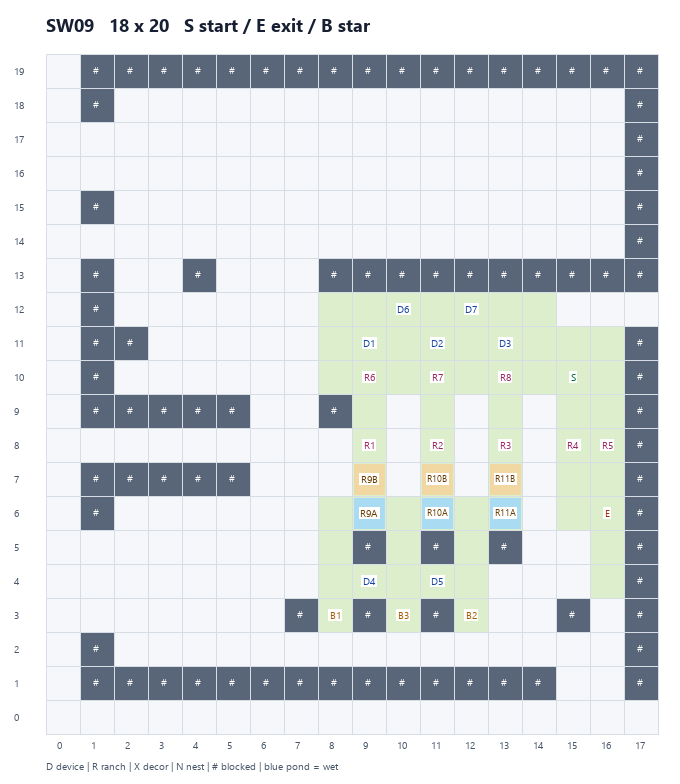

| 표시 | 장치 ID | 종류 | 기준 좌표 | 초기 점유 칸 | 방향과 연결 설정 |
|---|---|---|---|---|---|
| D1 | wind_1 | 바람 발생기 | (9,11) | (9,11) | 방향 ↓; 변형 blower |
| D2 | wind_2 | 바람 발생기 | (11,11) | (11,11) | 방향 ↓; 변형 blower |
| D3 | wind_3 | 바람 발생기 | (13,11) | (13,11) | 방향 ↓; 변형 blower |
| D4 | starsocket_1 | 별돌 | (9,4) | (9,4) | 번호 1 |
| D5 | starsocket_2 | 별 홈 | (11,4) | (11,4) | 변형 socket; 번호 1 |
| D6 | conveyor_1 | 무빙워크 | (10,12) | (10,12) | 방향 ← |
| D7 | conveyor_2 | 무빙워크 | (12,12) | (12,12) | 방향 ← |

| 표시 | 목장 기믹 | 기준 좌표 | 세부 배치 |
|---|---|---|---|
| R1 | 키 큰 풀 | (9,8) | 양과의 상호작용 대상인 풀 칸 |
| R2 | 키 큰 풀 | (11,8) | 양과의 상호작용 대상인 풀 칸 |
| R3 | 키 큰 풀 | (13,8) | 양과의 상호작용 대상인 풀 칸 |
| R4 | 키 큰 풀 | (15,8) | 양과의 상호작용 대상인 풀 칸 |
| R5 | 키 큰 풀 | (16,8) | 양과의 상호작용 대상인 풀 칸 |
| R6 | 양 | (9,10) | 초기 방향 → |
| R7 | 양 | (11,10) | 초기 방향 → |
| R8 | 양 | (13,10) | 초기 방향 → |
| R9 | 수문 | (9,6) | A (9,6) ↔ B (9,7); 초기 물 (9,6) |
| R10 | 수문 | (11,6) | A (11,6) ↔ B (11,7); 초기 물 (11,6) |
| R11 | 수문 | (13,6) | A (13,6) ↔ B (13,7); 초기 물 (13,6) |

추가 장치 목표(goals)는 없으며, 별 수집 목표와 출구가 승리 조건이다.

원본 시나리오 costLimit: 0 (제한 없음). 실제 HUD 예산에 적용되는 별도 기록과 구분한다.

### SW10

시나리오 제목: **네 잎 정류장**. 화면 연결: **SW11**. [원본 에셋](../Assets/ANIMOL/Data/Puzzle/MapData/starway/SW10_MapData.asset).

격자 18×20, 바닥 49칸(풀 49), 막힌 지형 42칸, 지형 없는 칸 269칸이다. 정적 바닥은 1개 영역으로 나뉜다.

시작 (5,7), 출구 (14,10). 별은 (8,7), (8,6), (7,10)에 있으며 수집 목표는 3개다.

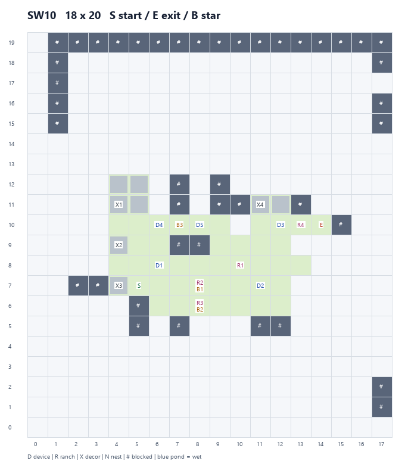

| 표시 | 장치 ID | 종류 | 기준 좌표 | 초기 점유 칸 | 방향과 연결 설정 |
|---|---|---|---|---|---|
| D1 | wind_1 | 바람 발생기 | (6,8) | (6,8) | 방향 →; 변형 blower; 초기 active=true |
| D2 | starsocket_1 | 별돌 | (11,7) | (11,7) | 번호 1 |
| D3 | starsocket_2 | 별 홈 | (12,10) | (12,10) | 변형 socket; 번호 1 |
| D4 | metalcrate_1 | 금속 상자 | (6,10) | (6,10) | 기본값 |
| D5 | conveyor_1 | 무빙워크 | (8,10) | (8,10) | 방향 ← |

| 표시 | 목장 기믹 | 기준 좌표 | 세부 배치 |
|---|---|---|---|
| R1 | 양 | (10,8) | 초기 방향 → |
| R2 | 양 | (8,7) | 초기 방향 → |
| R3 | 양 | (8,6) | 초기 방향 → |
| R4 | 키 큰 풀 | (13,10) | 양과의 상호작용 대상인 풀 칸 |

| 표시 | 장식 종류 또는 스프라이트 | 기준 좌표 | 실제 점유 칸 |
|---|---|---|---|
| X1 | chicken_coop_2x2 | (4,11) | (4,11), (5,11), (4,12), (5,12) |
| X2 | harvest_crate | (4,9) | (4,9) |
| X3 | honey_jar_stand | (4,7) | (4,7) |
| X4 | garden_workbench_2x1 | (11,11) | (11,11), (12,11) |

추가 장치 목표(goals)는 없으며, 별 수집 목표와 출구가 승리 조건이다.

원본 시나리오 costLimit: 0 (제한 없음). 실제 HUD 예산에 적용되는 별도 기록과 구분한다.

### SW11

시나리오 제목: **삼지창의 두 바람 높이**. 화면 연결: **SW12**. [원본 에셋](../Assets/ANIMOL/Data/Puzzle/MapData/starway/SW11_MapData.asset).

격자 18×20, 바닥 30칸(풀 30), 막힌 지형 38칸, 지형 없는 칸 292칸이다. 정적 바닥은 2개 영역으로 나뉜다.

시작 (6,2), 출구 (8,5). 별은 (2,4), (2,2)에 있으며 수집 목표는 2개다.

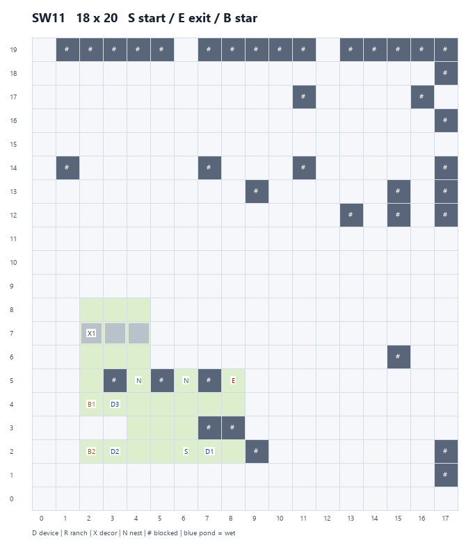

| 표시 | 장치 ID | 종류 | 기준 좌표 | 초기 점유 칸 | 방향과 연결 설정 |
|---|---|---|---|---|---|
| D1 | SW10_chick_1 | 병아리 | (7,2) | (7,2) | 방향 →; 추적 지연 1; 연결 그룹 SW10_chick_1 |
| D2 | chick_1 | 병아리 | (3,2) | (3,2) | 방향 →; 추적 지연 1 |
| D3 | onewaygate_1 | 일방통행 문 | (3,4) | (3,4) | 방향 → |

둥지: (4,5), (6,5).

| 표시 | 장식 종류 또는 스프라이트 | 기준 좌표 | 실제 점유 칸 |
|---|---|---|---|
| X1 | barnyard_3x2 | (2,7) | (2,7), (3,7), (4,7) |

추가 장치 목표(goals)는 없으며, 별 수집 목표와 출구가 승리 조건이다.

원본 시나리오 costLimit: 0 (제한 없음). 실제 HUD 예산에 적용되는 별도 기록과 구분한다.

### SW12

시나리오 제목: **대각선 날개의 급식 순서**. 화면 연결: **SW13**. [원본 에셋](../Assets/ANIMOL/Data/Puzzle/MapData/starway/SW12_MapData.asset).

격자 18×22, 바닥 46칸(풀 46), 막힌 지형 36칸, 지형 없는 칸 314칸이다. 정적 바닥은 2개 영역으로 나뉜다.

시작 (15,16), 출구 (8,13). 별은 (10,14)에 있으며 수집 목표는 1개다.

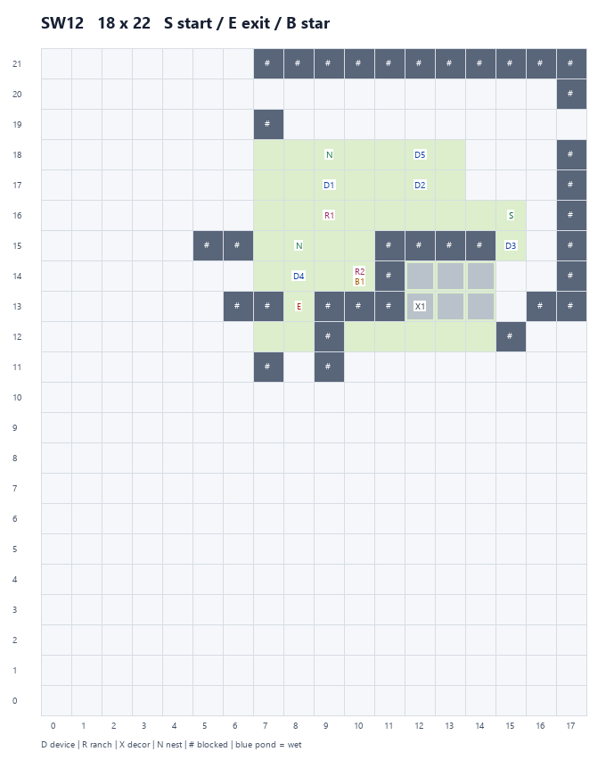

| 표시 | 장치 ID | 종류 | 기준 좌표 | 초기 점유 칸 | 방향과 연결 설정 |
|---|---|---|---|---|---|
| D1 | SW11_stone_1 | 별돌 | (9,17) | (9,17) | 번호 1; 연결 그룹 SW11_stone_1 |
| D2 | metalcrate_2 | 금속 상자 | (12,17) | (12,17) | 기본값 |
| D3 | chick_1 | 병아리 | (15,15) | (15,15) | 방향 →; 추적 지연 1 |
| D4 | starsocket_1 | 별 홈 | (8,14) | (8,14) | 변형 socket; 번호 1 |
| D5 | metalcrate_1 | 금속 상자 | (12,18) | (12,18) | 기본값 |

| 표시 | 목장 기믹 | 기준 좌표 | 세부 배치 |
|---|---|---|---|
| R1 | 양 | (9,16) | 초기 방향 → |
| R2 | 키 큰 풀 | (10,14) | 양과의 상호작용 대상인 풀 칸 |

둥지: (8,15), (9,18).

| 표시 | 장식 종류 또는 스프라이트 | 기준 좌표 | 실제 점유 칸 |
|---|---|---|---|
| X1 | produce_stall_3x2 | (12,13) | (12,13), (13,13), (14,13), (12,14), (13,14), (14,14) |

추가 장치 목표(goals)는 없으며, 별 수집 목표와 출구가 승리 조건이다.

원본 시나리오 costLimit: 0 (제한 없음). 실제 HUD 예산에 적용되는 별도 기록과 구분한다.

### SW13

시나리오 제목: **협곡의 왕복 수문**. 화면 연결: **SW14**. [원본 에셋](../Assets/ANIMOL/Data/Puzzle/MapData/starway/SW13_MapData.asset).

격자 18×22, 바닥 28칸(풀 28), 막힌 지형 34칸, 지형 없는 칸 334칸이다. 정적 바닥은 1개 영역으로 나뉜다.

시작 (10,15), 출구 (6,11). 별은 (12,11)에 있으며 수집 목표는 1개다.

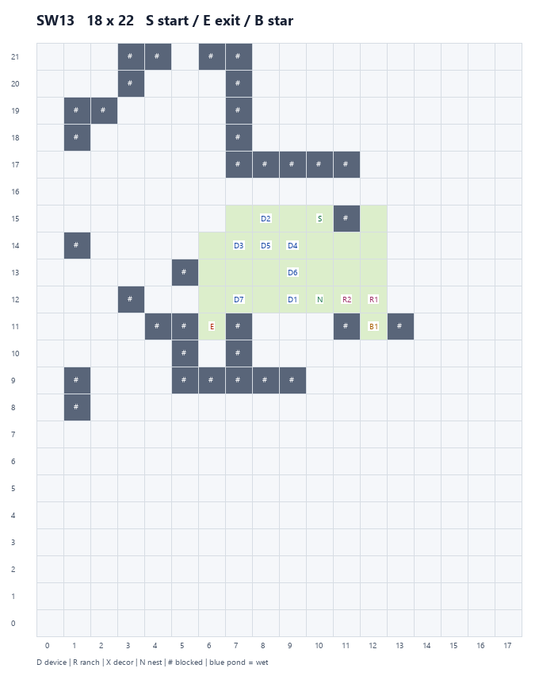

| 표시 | 장치 ID | 종류 | 기준 좌표 | 초기 점유 칸 | 방향과 연결 설정 |
|---|---|---|---|---|---|
| D1 | starsocket_1 | 별 홈 | (9,12) | (9,12) | 변형 socket; 번호 1 |
| D2 | metalcrate_1 | 금속 상자 | (8,15) | (8,15) | 기본값 |
| D3 | metalcrate_2 | 금속 상자 | (7,14) | (7,14) | 기본값 |
| D4 | metalcrate_3 | 금속 상자 | (9,14) | (9,14) | 기본값 |
| D5 | starsocket_2 | 별돌 | (8,14) | (8,14) | 번호 1 |
| D6 | metalcrate_4 | 금속 상자 | (9,13) | (9,13) | 기본값 |
| D7 | chick_1 | 병아리 | (7,12) | (7,12) | 방향 →; 추적 지연 1 |

| 표시 | 목장 기믹 | 기준 좌표 | 세부 배치 |
|---|---|---|---|
| R1 | 키 큰 풀 | (12,12) | 양과의 상호작용 대상인 풀 칸 |
| R2 | 양 | (11,12) | 초기 방향 → |

둥지: (10,12).

추가 장치 목표(goals)는 없으며, 별 수집 목표와 출구가 승리 조건이다.

원본 시나리오 costLimit: 0 (제한 없음). 실제 HUD 예산에 적용되는 별도 기록과 구분한다.

### SW14

시나리오 제목: **세 앞마당의 두 행렬**. 화면 연결: **SW15**. [원본 에셋](../Assets/ANIMOL/Data/Puzzle/MapData/starway/SW14_MapData.asset).

격자 18×22, 바닥 31칸(풀 31), 막힌 지형 33칸, 지형 없는 칸 332칸이다. 정적 바닥은 2개 영역으로 나뉜다.

시작 (10,6), 출구 (8,9). 별은 (5,5)에 있으며 수집 목표는 1개다.

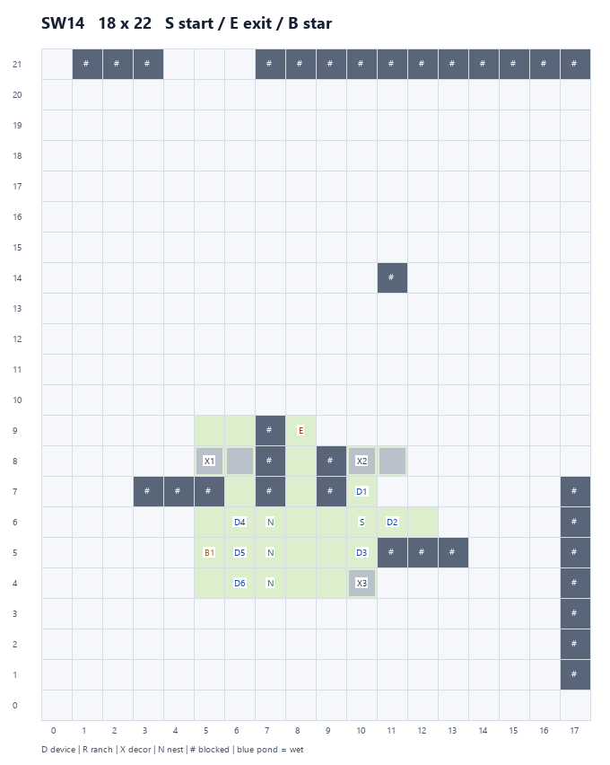

| 표시 | 장치 ID | 종류 | 기준 좌표 | 초기 점유 칸 | 방향과 연결 설정 |
|---|---|---|---|---|---|
| D1 | chick_1 | 병아리 | (10,7) | (10,7) | 방향 →; 추적 지연 1 |
| D2 | chick_3 | 병아리 | (11,6) | (11,6) | 방향 →; 추적 지연 1 |
| D3 | chick_4 | 병아리 | (10,5) | (10,5) | 방향 →; 추적 지연 1 |
| D4 | metalcrate_1 | 금속 상자 | (6,6) | (6,6) | 기본값 |
| D5 | metalcrate_2 | 금속 상자 | (6,5) | (6,5) | 기본값 |
| D6 | metalcrate_3 | 금속 상자 | (6,4) | (6,4) | 기본값 |

둥지: (7,6), (7,4), (7,5).

| 표시 | 장식 종류 또는 스프라이트 | 기준 좌표 | 실제 점유 칸 |
|---|---|---|---|
| X1 | windmill_body.png | (5,8) | (5,8), (6,8) |
| X2 | hay_store_2x1 | (10,8) | (10,8), (11,8) |
| X3 | feed_sack_stack | (10,4) | (10,4) |

추가 장치 목표(goals)는 없으며, 별 수집 목표와 출구가 승리 조건이다.

원본 시나리오 costLimit: 0 (제한 없음). 실제 HUD 예산에 적용되는 별도 기록과 구분한다.

### SW15

시나리오 제목: **두 번 꺾이는 바람의 뜰**. 화면 연결: **SW16**. [원본 에셋](../Assets/ANIMOL/Data/Puzzle/MapData/starway/SW15_MapData.asset).

격자 18×22, 바닥 75칸(풀 75), 막힌 지형 76칸, 지형 없는 칸 245칸이다. 정적 바닥은 5개 영역으로 나뉜다.

시작 (15,15), 출구 (8,16). 별은 (8,14)에 있으며 수집 목표는 1개다.

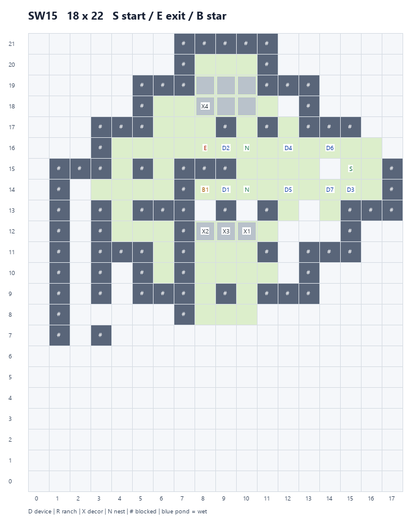

| 표시 | 장치 ID | 종류 | 기준 좌표 | 초기 점유 칸 | 방향과 연결 설정 |
|---|---|---|---|---|---|
| D1 | starsocket_1 | 별 홈 | (9,14) | (9,14) | 변형 socket; 번호 1 |
| D2 | starsocket_2 | 별 홈 | (9,16) | (9,16) | 변형 socket; 번호 1 |
| D3 | chick_2 | 병아리 | (15,14) | (15,14) | 방향 →; 추적 지연 1 |
| D4 | starsocket_3 | 별돌 | (12,16) | (12,16) | 번호 1 |
| D5 | starsocket_4 | 별돌 | (12,14) | (12,14) | 번호 1 |
| D6 | metalcrate_2 | 금속 상자 | (14,16) | (14,16) | 기본값 |
| D7 | chick_1 | 병아리 | (14,14) | (14,14) | 방향 →; 추적 지연 1 |

둥지: (10,16), (10,14).

| 표시 | 장식 종류 또는 스프라이트 | 기준 좌표 | 실제 점유 칸 |
|---|---|---|---|
| X1 | milk_can_pair | (10,12) | (10,12) |
| X2 | milk_can_pair | (8,12) | (8,12) |
| X3 | tool_basket | (9,12) | (9,12) |
| X4 | produce_stall_3x2 | (8,18) | (8,18), (9,18), (10,18), (8,19), (9,19), (10,19) |

추가 장치 목표(goals)는 없으며, 별 수집 목표와 출구가 승리 조건이다.

원본 시나리오 costLimit: 0 (제한 없음). 실제 HUD 예산에 적용되는 별도 기록과 구분한다.

### SW16

시나리오 제목: **바람을 꺾는 연섬**. 화면 연결: **SW17**. [원본 에셋](../Assets/ANIMOL/Data/Puzzle/MapData/starway/SW16_MapData.asset).

격자 18×22, 바닥 65칸(풀 65), 막힌 지형 7칸, 지형 없는 칸 324칸이다. 정적 바닥은 1개 영역으로 나뉜다.

시작 (11,10), 출구 (14,15). 별은 (9,11), (15,11), (12,14), (12,8)에 있으며 수집 목표는 3개다.

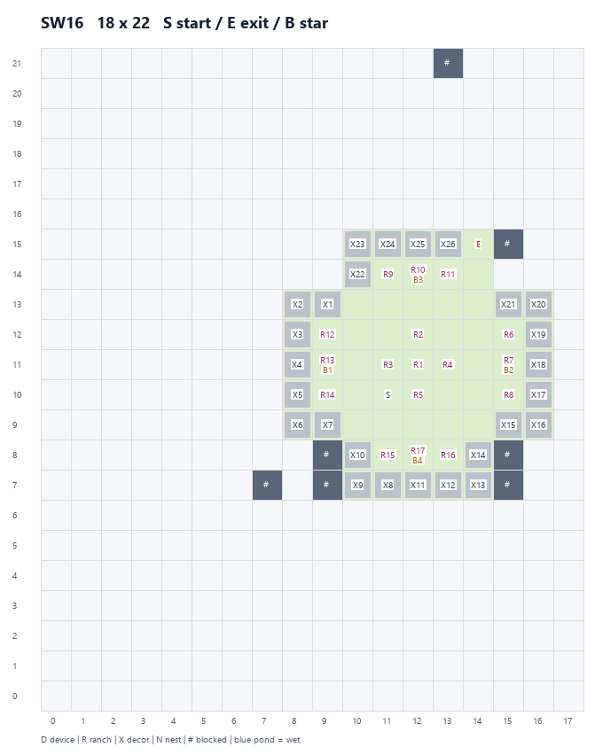

시나리오 장치 D는 없다.

| 표시 | 목장 기믹 | 기준 좌표 | 세부 배치 |
|---|---|---|---|
| R1 | 양 | (12,11) | 초기 방향 → |
| R2 | 양 | (12,12) | 초기 방향 → |
| R3 | 양 | (11,11) | 초기 방향 → |
| R4 | 양 | (13,11) | 초기 방향 → |
| R5 | 양 | (12,10) | 초기 방향 → |
| R6 | 키 큰 풀 | (15,12) | 양과의 상호작용 대상인 풀 칸 |
| R7 | 키 큰 풀 | (15,11) | 양과의 상호작용 대상인 풀 칸 |
| R8 | 키 큰 풀 | (15,10) | 양과의 상호작용 대상인 풀 칸 |
| R9 | 키 큰 풀 | (11,14) | 양과의 상호작용 대상인 풀 칸 |
| R10 | 키 큰 풀 | (12,14) | 양과의 상호작용 대상인 풀 칸 |
| R11 | 키 큰 풀 | (13,14) | 양과의 상호작용 대상인 풀 칸 |
| R12 | 키 큰 풀 | (9,12) | 양과의 상호작용 대상인 풀 칸 |
| R13 | 키 큰 풀 | (9,11) | 양과의 상호작용 대상인 풀 칸 |
| R14 | 키 큰 풀 | (9,10) | 양과의 상호작용 대상인 풀 칸 |
| R15 | 키 큰 풀 | (11,8) | 양과의 상호작용 대상인 풀 칸 |
| R16 | 키 큰 풀 | (13,8) | 양과의 상호작용 대상인 풀 칸 |
| R17 | 키 큰 풀 | (12,8) | 양과의 상호작용 대상인 풀 칸 |

| 표시 | 장식 종류 또는 스프라이트 | 기준 좌표 | 실제 점유 칸 |
|---|---|---|---|
| X1 | raised_flower_meadow | (9,13) | (9,13) |
| X2 | raised_flower_meadow | (8,13) | (8,13) |
| X3 | raised_flower_meadow | (8,12) | (8,12) |
| X4 | raised_flower_meadow | (8,11) | (8,11) |
| X5 | raised_flower_meadow | (8,10) | (8,10) |
| X6 | raised_flower_meadow | (8,9) | (8,9) |
| X7 | raised_flower_meadow | (9,9) | (9,9) |
| X8 | raised_flower_meadow | (11,7) | (11,7) |
| X9 | raised_flower_meadow | (10,7) | (10,7) |
| X10 | raised_flower_meadow | (10,8) | (10,8) |
| X11 | raised_flower_meadow | (12,7) | (12,7) |
| X12 | raised_flower_meadow | (13,7) | (13,7) |
| X13 | raised_flower_meadow | (14,7) | (14,7) |
| X14 | raised_flower_meadow | (14,8) | (14,8) |
| X15 | raised_flower_meadow | (15,9) | (15,9) |
| X16 | raised_flower_meadow | (16,9) | (16,9) |
| X17 | raised_flower_meadow | (16,10) | (16,10) |
| X18 | raised_flower_meadow | (16,11) | (16,11) |
| X19 | raised_flower_meadow | (16,12) | (16,12) |
| X20 | raised_flower_meadow | (16,13) | (16,13) |
| X21 | raised_flower_meadow | (15,13) | (15,13) |
| X22 | raised_flower_meadow | (10,14) | (10,14) |
| X23 | raised_flower_meadow | (10,15) | (10,15) |
| X24 | raised_flower_meadow | (11,15) | (11,15) |
| X25 | raised_flower_meadow | (12,15) | (12,15) |
| X26 | raised_flower_meadow | (13,15) | (13,15) |

추가 장치 목표(goals)는 없으며, 별 수집 목표와 출구가 승리 조건이다.

원본 시나리오 costLimit: 0 (제한 없음). 실제 HUD 예산에 적용되는 별도 기록과 구분한다.

### SW17

시나리오 제목: **쌍고리의 두 둥지**. 화면 연결: **SW18**. [원본 에셋](../Assets/ANIMOL/Data/Puzzle/MapData/starway/SW17_MapData.asset).

격자 18×22, 바닥 36칸(풀 36), 막힌 지형 0칸, 지형 없는 칸 360칸이다. 정적 바닥은 1개 영역으로 나뉜다.

시작 (9,7), 출구 (16,7). 별은 (12,4), (10,5), (12,10)에 있으며 수집 목표는 3개다.

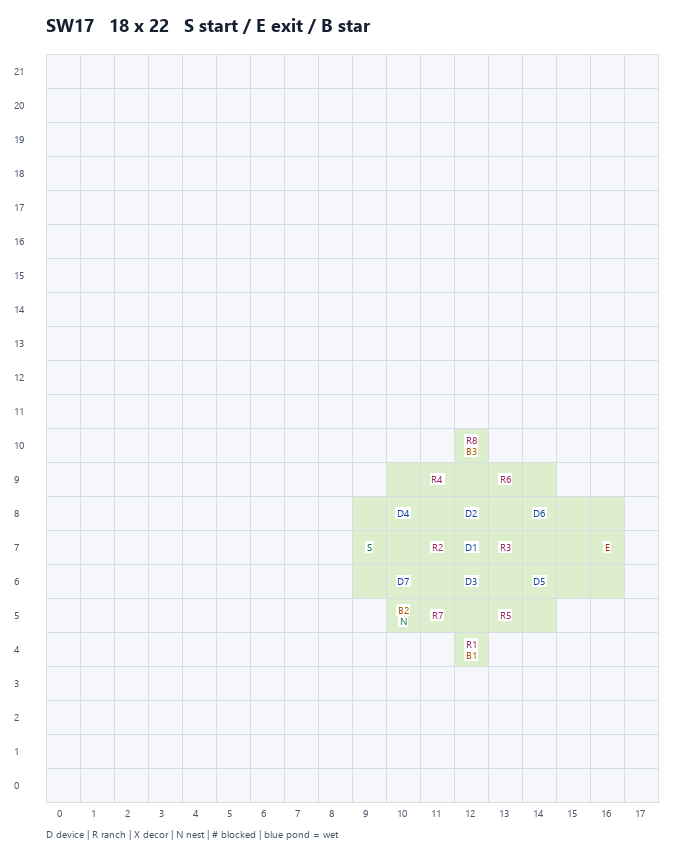

| 표시 | 장치 ID | 종류 | 기준 좌표 | 초기 점유 칸 | 방향과 연결 설정 |
|---|---|---|---|---|---|
| D1 | chick_1 | 병아리 | (12,7) | (12,7) | 방향 →; 추적 지연 1 |
| D2 | metalcrate_5 | 금속 상자 | (12,8) | (12,8) | 기본값 |
| D3 | metalcrate_6 | 금속 상자 | (12,6) | (12,6) | 기본값 |
| D4 | metalcrate_1 | 금속 상자 | (10,8) | (10,8) | 기본값 |
| D5 | metalcrate_2 | 금속 상자 | (14,6) | (14,6) | 기본값 |
| D6 | metalcrate_3 | 금속 상자 | (14,8) | (14,8) | 기본값 |
| D7 | metalcrate_4 | 금속 상자 | (10,6) | (10,6) | 기본값 |

| 표시 | 목장 기믹 | 기준 좌표 | 세부 배치 |
|---|---|---|---|
| R1 | 키 큰 풀 | (12,4) | 양과의 상호작용 대상인 풀 칸 |
| R2 | 양 | (11,7) | 초기 방향 → |
| R3 | 양 | (13,7) | 초기 방향 → |
| R4 | 키 큰 풀 | (11,9) | 양과의 상호작용 대상인 풀 칸 |
| R5 | 키 큰 풀 | (13,5) | 양과의 상호작용 대상인 풀 칸 |
| R6 | 키 큰 풀 | (13,9) | 양과의 상호작용 대상인 풀 칸 |
| R7 | 키 큰 풀 | (11,5) | 양과의 상호작용 대상인 풀 칸 |
| R8 | 키 큰 풀 | (12,10) | 양과의 상호작용 대상인 풀 칸 |

둥지: (10,5).

추가 장치 목표(goals)는 없으며, 별 수집 목표와 출구가 승리 조건이다.

원본 시나리오 costLimit: 0 (제한 없음). 실제 HUD 예산에 적용되는 별도 기록과 구분한다.

### SW18

시나리오 제목: **왕관 능선의 교환 순서**. 화면 연결: **SW19**. [원본 에셋](../Assets/ANIMOL/Data/Puzzle/MapData/starway/SW18_MapData.asset).

격자 18×22, 바닥 49칸(풀 49), 막힌 지형 0칸, 지형 없는 칸 347칸이다. 정적 바닥은 1개 영역으로 나뉜다.

시작 (7,10), 출구 (2,6). 별은 (2,11)에 있으며 수집 목표는 1개다.

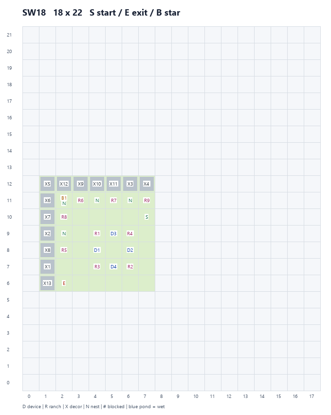

| 표시 | 장치 ID | 종류 | 기준 좌표 | 초기 점유 칸 | 방향과 연결 설정 |
|---|---|---|---|---|---|
| D1 | chick_1 | 병아리 | (4,8) | (4,8) | 방향 →; 추적 지연 1 |
| D2 | chick_2 | 병아리 | (6,8) | (6,8) | 방향 →; 추적 지연 1 |
| D3 | chick_3 | 병아리 | (5,9) | (5,9) | 방향 →; 추적 지연 1 |
| D4 | chick_4 | 병아리 | (5,7) | (5,7) | 방향 →; 추적 지연 1 |

| 표시 | 목장 기믹 | 기준 좌표 | 세부 배치 |
|---|---|---|---|
| R1 | 양 | (4,9) | 초기 방향 → |
| R2 | 양 | (6,7) | 초기 방향 → |
| R3 | 양 | (4,7) | 초기 방향 → |
| R4 | 양 | (6,9) | 초기 방향 → |
| R5 | 키 큰 풀 | (2,8) | 양과의 상호작용 대상인 풀 칸 |
| R6 | 키 큰 풀 | (3,11) | 양과의 상호작용 대상인 풀 칸 |
| R7 | 키 큰 풀 | (5,11) | 양과의 상호작용 대상인 풀 칸 |
| R8 | 키 큰 풀 | (2,10) | 양과의 상호작용 대상인 풀 칸 |
| R9 | 키 큰 풀 | (7,11) | 양과의 상호작용 대상인 풀 칸 |

둥지: (2,9), (2,11), (4,11), (6,11).

| 표시 | 장식 종류 또는 스프라이트 | 기준 좌표 | 실제 점유 칸 |
|---|---|---|---|
| X1 | raised_flower_meadow | (1,7) | (1,7) |
| X2 | raised_flower_meadow | (1,9) | (1,9) |
| X3 | raised_flower_meadow | (6,12) | (6,12) |
| X4 | raised_flower_meadow | (7,12) | (7,12) |
| X5 | raised_flower_meadow | (1,12) | (1,12) |
| X6 | raised_flower_meadow | (1,11) | (1,11) |
| X7 | raised_flower_meadow | (1,10) | (1,10) |
| X8 | raised_flower_meadow | (1,8) | (1,8) |
| X9 | raised_flower_meadow | (3,12) | (3,12) |
| X10 | raised_flower_meadow | (4,12) | (4,12) |
| X11 | raised_flower_meadow | (5,12) | (5,12) |
| X12 | raised_flower_meadow | (2,12) | (2,12) |
| X13 | raised_flower_meadow | (1,6) | (1,6) |

추가 장치 목표(goals)는 없으며, 별 수집 목표와 출구가 승리 조건이다.

원본 시나리오 costLimit: 0 (제한 없음). 실제 HUD 예산에 적용되는 별도 기록과 구분한다.

### SW19

시나리오 제목: **짧은 바람과 긴 바람의 회랑**. 화면 연결: **SW20**. [원본 에셋](../Assets/ANIMOL/Data/Puzzle/MapData/starway/SW19_MapData.asset).

격자 18×22, 바닥 56칸(풀 56), 막힌 지형 0칸, 지형 없는 칸 340칸이다. 정적 바닥은 1개 영역으로 나뉜다.

시작 (15,9), 출구 (8,9). 별은 (16,6), (10,9)에 있으며 수집 목표는 2개다.

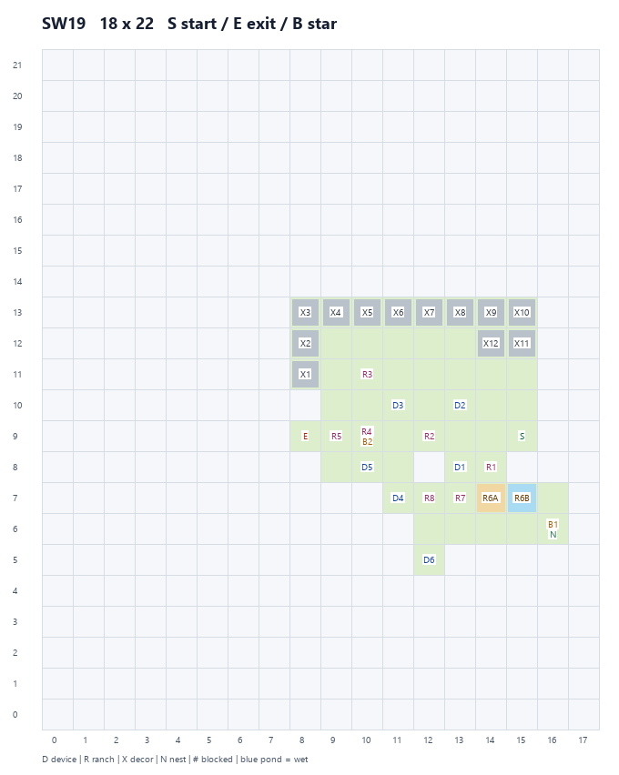

| 표시 | 장치 ID | 종류 | 기준 좌표 | 초기 점유 칸 | 방향과 연결 설정 |
|---|---|---|---|---|---|
| D1 | wind_1 | 바람 발생기 | (13,8) | (13,8) | 방향 ↑; 변형 blower; 초기 active=true |
| D2 | bounce_1 | 반사판 | (13,10) | (13,10) | 회전값 1 |
| D3 | bounce_4 | 반사판 | (11,10) | (11,10) | 회전값 0 |
| D4 | bounce_2 | 반사판 | (11,7) | (11,7) | 회전값 3 |
| D5 | metalcrate_1 | 금속 상자 | (10,8) | (10,8) | 기본값 |
| D6 | chick_1 | 병아리 | (12,5) | (12,5) | 방향 →; 추적 지연 1 |

| 표시 | 목장 기믹 | 기준 좌표 | 세부 배치 |
|---|---|---|---|
| R1 | 양 | (14,8) | 초기 방향 → |
| R2 | 양 | (12,9) | 초기 방향 → |
| R3 | 양 | (10,11) | 초기 방향 → |
| R4 | 키 큰 풀 | (10,9) | 양과의 상호작용 대상인 풀 칸 |
| R5 | 키 큰 풀 | (9,9) | 양과의 상호작용 대상인 풀 칸 |
| R6 | 수문 | (14,7) | A (14,7) ↔ B (15,7); 초기 물 (15,7) |
| R7 | 키 큰 풀 | (13,7) | 양과의 상호작용 대상인 풀 칸 |
| R8 | 키 큰 풀 | (12,7) | 양과의 상호작용 대상인 풀 칸 |

둥지: (16,6).

| 표시 | 장식 종류 또는 스프라이트 | 기준 좌표 | 실제 점유 칸 |
|---|---|---|---|
| X1 | raised_flower_meadow | (8,11) | (8,11) |
| X2 | raised_flower_meadow | (8,12) | (8,12) |
| X3 | raised_flower_meadow | (8,13) | (8,13) |
| X4 | raised_flower_meadow | (9,13) | (9,13) |
| X5 | raised_flower_meadow | (10,13) | (10,13) |
| X6 | raised_flower_meadow | (11,13) | (11,13) |
| X7 | raised_flower_meadow | (12,13) | (12,13) |
| X8 | raised_flower_meadow | (13,13) | (13,13) |
| X9 | raised_flower_meadow | (14,13) | (14,13) |
| X10 | raised_flower_meadow | (15,13) | (15,13) |
| X11 | raised_flower_meadow | (15,12) | (15,12) |
| X12 | tool_basket | (14,12) | (14,12) |

추가 장치 목표(goals)는 없으며, 별 수집 목표와 출구가 승리 조건이다.

원본 시나리오 costLimit: 0 (제한 없음). 실제 HUD 예산에 적용되는 별도 기록과 구분한다.

### SW21

시나리오 제목: **별가지의 마지막 귀환**. 화면 연결: **없음**. [원본 에셋](../Assets/ANIMOL/Data/Puzzle/MapData/starway/SW21_MapData.asset).

격자 18×22, 바닥 136칸(풀 136), 막힌 지형 156칸, 지형 없는 칸 104칸이다. 정적 바닥은 1개 영역으로 나뉜다.

시작 (4,18), 출구 (14,2). 별은 (4,20), (6,20), (13,6)에 있으며 수집 목표는 3개다.

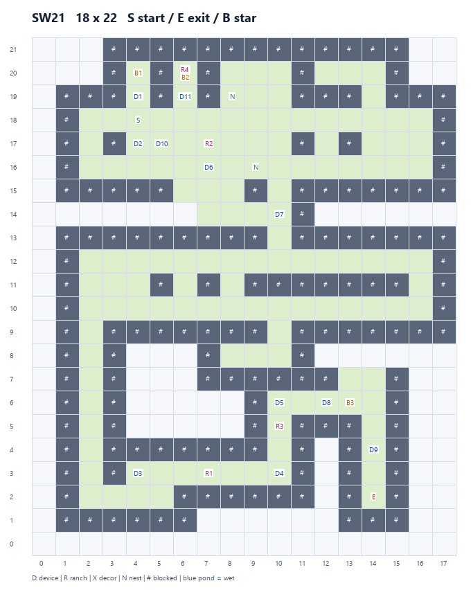

| 표시 | 장치 ID | 종류 | 기준 좌표 | 초기 점유 칸 | 방향과 연결 설정 |
|---|---|---|---|---|---|
| D1 | SW20_chick_1 | 병아리 | (4,19) | (4,19) | 방향 →; 추적 지연 1; 둥지 (8,19); 연결 그룹 SW20_chick_1 |
| D2 | SW20_chick_2 | 병아리 | (4,17) | (4,17) | 방향 →; 추적 지연 3; 둥지 (9,16); 연결 그룹 SW20_chick_2 |
| D3 | SW20_wind_1 | 바람 발생기 | (4,3) | (4,3) | 방향 →; 변형 blower; 연결 그룹 SW20_wind_1 |
| D4 | SW20_reflector_1 | 반사판 | (10,3) | (10,3) | 회전값 2; 연결 그룹 SW20_reflector_1 |
| D5 | SW20_brake_1 | 브레이크 | (10,6) | (10,6) | 연결 그룹 SW20_brake_1 |
| D6 | SW20_stone_1 | 별돌 | (7,16) | (7,16) | 번호 1; 연결 그룹 SW20_stone_1 |
| D7 | SW20_socket_1 | 별 홈 | (10,14) | (10,14) | 변형 socket; 번호 1; 연결 그룹 SW20_socket_1 |
| D8 | SW20_stone_2 | 별돌 | (12,6) | (12,6) | 번호 2; 연결 그룹 SW20_stone_2 |
| D9 | SW20_socket_2 | 별 홈 | (14,4) | (14,4) | 변형 socket; 번호 2; 연결 그룹 SW20_socket_2 |
| D10 | SW20_stone_3 | 별돌 | (5,17) | (5,17) | 번호 3; 연결 그룹 SW20_stone_3 |
| D11 | SW20_socket_3 | 별 홈 | (6,19) | (6,19) | 변형 socket; 번호 3; 연결 그룹 SW20_socket_3 |

| 표시 | 목장 기믹 | 기준 좌표 | 세부 배치 |
|---|---|---|---|
| R1 | 양 | (7,3) | 초기 방향 → |
| R2 | 양 | (7,17) | 초기 방향 → |
| R3 | 키 큰 풀 | (10,5) | 양과의 상호작용 대상인 풀 칸 |
| R4 | 키 큰 풀 | (6,20) | 양과의 상호작용 대상인 풀 칸 |

둥지: (8,19), (9,16).

추가 장치 목표(goals)는 없으며, 별 수집 목표와 출구가 승리 조건이다.

원본 시나리오 costLimit: 0 (제한 없음). 실제 HUD 예산에 적용되는 별도 기록과 구분한다.

## 현재 규칙과 연결 해석

잔영 극장의 돌진 석상은 유리를 부수되 유리가 있던 칸에 들어가지 않고 바로 앞에서 이번 돌진을 끝낸다. 이후 재조준·재돌진할 수 있다. 장치의 방향·번호·변형은 위 표의 저장값을 따른다. 자세한 판정은 [현재 장치 규칙](ANIMOL_DEVICE_RULES_CURRENT.md)을 참조한다.

초기 별 배치 수와 필요한 수집 수는 각 맵 표의 현재 값을 따른다. 표의 초기 점유 칸과 바닥 통계는 이동 후 상태나 해답 경로를 뜻하지 않는다.

현재 [별길 목장 최단 경로](STARWAY_SHORTEST_PATHS.md)와 [잔영 극장 최단 경로](ECHO_THEATER_SHORTEST_PATHS.md)는 별도 카탈로그에 기록한다. 경로·최단성 근거·공개 API 재생 검증은 별도 보고서에 기록했다.

## 자료와 검증

Unity 6000.3.8f1에서 실제 로드된 MapData와 Scenario를 읽었다. 32개 맵의 ValidateMap 결과는 모두 오류 0개이며, 이는 배치 데이터 검사 결과다. 원본 에셋과 메타의 SHA-256, 미저장 표시, 저장본과의 비교는 [검증 기록](Validation/MapLayoutReport/audit.json), 전체 좌표와 원본 필드는 [데이터 스냅샷](Validation/MapLayoutReport/unity_snapshot.json)에 있다.

원본 맵·메타·작성된 verificationRoute를 저장하거나 수정하지 않았다. 게임 완주나 모바일 표시 검증을 배치 검사 결과에 포함하지 않는다.
