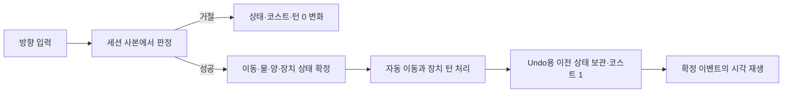

# 별길 목장 맵 장치·동작 구조 리포트

2026-10-28 기준 현재 작업 트리의 코드·맵 에셋과 기존 Unity 실행 결과를 대조한 현황이다. 테마 저장 키는 `starway`다. 이 문서는 별길 목장에만 적용되는 연결과 그 맵에서 사용하는 공통 퍼즐 기반을 다룬다. 아래의 “구현”은 해당 실행 경로에 코드가 연결됐다는 뜻이며, 모든 캠페인 스테이지에서 사람이 화면으로 확인했다는 뜻은 아니다.

## 먼저 구분해야 할 두 실행 경로

| 경로 | 실제 맵과 판정 | 장치 범위 |
|---|---|---|
| 기본 플레이 씬 [`ANIMOL_Puzzle`](../Assets/ANIMOL/Scenes/Runtime/ANIMOL_Puzzle.unity) | `StarGarden.asset` → `PuzzleController` → `PuzzleSession` | 현재 `StarGarden`은 `scenario` 참조가 없다. `PuzzleMap.devices`의 기존 `DeviceCell`(무빙워크·바람·얼음·제동판·포털)로 이동한다. V13 양·수문·둥지 귀환 판정은 이 경로에서 실행되지 않는다. |
| 별길 목장 장치 프로토타입 씬 [`ANIMOL_starway_Prototype`](../Assets/ANIMOL/Scenes/Prototype/ANIMOL_starway_Prototype.unity) 및 시나리오가 연결된 맵 | `starway.asset`/`PuzzleScenario` → `PuzzlePrototypeController` → `PuzzleDeviceSession` | 개별 장치, 코스트, 자동 이동 연쇄, 방울·목표·출구, V13 R2~R4 판정을 사용한다. `PuzzleController.Start`도 시나리오가 있으면 이 컨트롤러로 넘긴다. |
| 아트 QA·검사 보드 | 표시와 클립 재생 검사 | 실제 퍼즐 판정이나 캠페인 스테이지의 대체물이 아니다. |

따라서 **제작기 목록에 보이는 장치**, **시나리오 맵에서 작동하는 장치**, **현재 기본 플레이 씬에 배치된 장치**는 서로 같은 집합이 아니다. 예를 들어 현재 기본 씬의 `StarGarden`에는 시나리오가 없고, 현재 로컬 `1-1_Scenario.asset`에는 병아리가 있지만 그 병아리의 `target`은 `(0,0)`으로 저장돼 있다. 후자는 사용자 미커밋 맵의 현 상태를 읽은 결과이며 배치 데이터는 수정하지 않았다.

## 맵 데이터와 제작기

| 데이터 | 저장 내용과 역할 |
|---|---|
| [`PuzzleMap`](../Assets/ANIMOL/Scripts/Runtime/PuzzleMap.cs) | 크기, 지형·막힘, 시작·출구, 방울, 카메라 설정, `DeviceCell`, 장식, 테마, 선택적 시나리오. 크기 축소 때 범위 밖 기록을 즉시 삭제하지 않는다. |
| [`PuzzleScenario`](../Assets/ANIMOL/Scripts/Runtime/PuzzleScenario.cs) | `PrototypeDevice`의 ID·역할·변형·방향·연결 그룹·목표·레일 등, 고정 `water`, `ranchV13Art`, 추가 목표와 코스트 한도. `sheep`/`sluice`/`tall_grass`는 공식 장치 번호를 새로 만들지 않고 family와 인스턴스 ID로 저장한다. |
| [`PuzzleMapEditor`](../Assets/ANIMOL/Scripts/Editor/PuzzleMapEditor.cs) | 별길 목장 테마 장치 목록 맨 앞에 **별양, 가로 수문, 세로 수문, 키 큰 풀, 병아리 둥지, 물칸**을 보여 준다. 이어 기존 테마 장치 템플릿을 보여 준다. 수문은 A와 이웃 B의 두 칸을 점유한다. 둥지는 병아리 `target`이며, 병아리가 없으면 둥지 칸을 고른 뒤 시작 칸을 고르는 두 단계 배치다. 물칸은 `scenario.water`다. |
| 별길 목장 연결 장식 V02 R2 | `PuzzleMap.decorations`와 manifest pin·카탈로그를 통해 연결형 6종, 다칸 소품 12종, 한 칸 소품 8종을 표시한다. 장식의 그룹 렌더러와 지면 pivot은 통행 점유와 구분한다. 장식이 양·병아리·수문 판정을 소유하지 않는다. |

제작기는 수문 두 칸의 상하좌우 인접, 점유 중복, 젖은 시작 칸, 둥지의 통행 가능 여부 등을 검사한다. 별길 목장의 **옛 덩굴 다리**는 새 테마 템플릿 목록에서 제외되어 있다. 과거 프로토타입 시나리오에 직렬화된 02번 누름판·다리는 남아 있으므로 기존 맵의 동작을 갑자기 없애지는 않는다. 장식의 큰 캔버스도 점유 칸 수·Collider·코스트로 환산하지 않는다.

## 별길 목장에서 다루는 장치

| 장치/표현 | 현재 판정과 배치 관계 |
|---|---|
| 01 별돌·별 홈 | 별돌을 밀어 같은 문양 홈에 넣으면 돌을 제거하고 홈을 활성화한다. 다른 문양이면 이동을 거절하며 코스트·턴은 증가하지 않는다. 홈의 보상은 저장된 `socketReward`에 따른다. |
| 02 누름판·덩굴 다리 | 점유에 따라 연결 그룹을 켜고 끄는 기존 로직이다. 새 별길 목장 목록에서는 제외된 레거시 배치다. |
| 07 무빙워크, 18 반사판, 19 제동판 | 무빙워크는 강제 이동 방향을 정하고, 반사판은 진입 방향을 꺾으며, 제동판은 강제 이동을 멈춘다. 실제 이동 경로는 세션이 결정한다. |
| 09 일방향 문 | 방향·출구 점유를 검사하고 허용 시 통과한다. 표시도 요청에 따라 **V12**로 유지한다. |
| 20 바람개비·바람 | 본체는 고정이고 입력으로 off/3/6/9 단계를 순환한다. 실제 유효 셀을 추적하며 금속 상자와 다른 차단체, 반사판을 고려한다. 플레이어·지원되는 이동 대상의 자동 이동은 해당 경로에서 처리하며 자동 단계의 추가 비용은 없다. 현재 `WindMovable`에는 병아리가 없고 바람 경로에서 차단체로 판정된다. 고정 `DeviceCell.Wind`는 자기 칸의 고전 바람으로, 범위형 바람개비와 별개다. |
| 24 병아리·둥지 | 병아리는 기존 **V12 추종·길막·일반 누름판 점유** 규칙을 유지한다. 플레이어가 지나간 인접 칸의 기록을 따라가고 `number`가 추종 지연 길이에 쓰인다. 목표 둥지가 지정되고 같은 칸 또는 빈 이웃 칸에 도달하면 추종을 멈추고 귀환 상태가 된다. R4는 성공 뒤 실제 접근 이동과 네 방향 합성 도약·앉기 표시를 추가한다. 단순 근접만으로 보상이나 귀환 애니메이션을 만들지 않는다. |
| V13 R2 별양·키 큰 풀 | 직접 밀면 **플레이어는 제자리**, 양만 한 칸 이동한다. 처음 만난 키 큰 풀을 먹으면 양과 풀이 함께 사라지고 바닥이 남는다. 바람 중에도 실제 경로의 첫 풀에서 소멸하며 다음 풀을 계속 먹지 않는다. |
| V13 R3 수문 | 한 인스턴스의 A/B 두 인접 칸을 2×1 또는 1×2로 저장하고 정확히 한 칸을 젖게 둔다. 마른 짝 칸의 플레이어가 물칸 쪽으로 입력할 때, 물은 **행동 전 물칸→마른 칸**, 플레이어는 반대로 이동한다. 점유 검사 뒤 하나의 성공으로 물 위상·플레이어·코스트를 확정한다. 다른 물칸을 한꺼번에 토글하지 않는다. |
| 고정 물칸·나무/금속 상자 | 고정 물은 `scenario.water`의 기존 진입 판정을 사용하고 수문 두 칸과 겹치지 않게 배치한다. 나무 상자는 밀기·바람 운반 대상이고 금속 상자는 바람 경로를 막는다. 공통 장치 역할을 별길 목장 그림에 연결한 것이다. |

별길 목장 시나리오에도 다른 공통 `PrototypeRole`을 저장할 수 있지만, 다른 테마 전용 장치의 모든 규칙을 별길 목장의 신규 기획으로 간주하지 않는다. `RanchDevicesV13PuzzleBinding`은 별돌·무빙워크·반사판·제동판·바람개비·상자 등의 V13 시각을 연결한다. 병아리 본체와 일방향 문은 V12 바인딩을 유지한다.

## 한 입력의 처리 순서와 권한

`PuzzleDeviceSession.Apply`는 현재 상태의 복사본에서 `Resolve`를 실행하고 성공할 때만 이전 스냅샷을 Undo 스택에 넣고 새 상태를 반영한다. 양 밀기와 수문 교환은 일반 진입·밀기 경로보다 먼저 분기한다. 일반 이동은 통행·문·포털/도약 착지·점유를 검사한 뒤 `Leave → Move → Enter → Follow → RefreshLinks → TraceWind`를 거친다. 이후 포털·일방향 문·도약대·제동판·무빙워크·바람·얼음·반사판의 자동 연쇄를 처리하고, 성공한 한 입력에 대해서만 `Cost++`와 `EndTurn`을 수행한다. 방울·방문·추가 목표와 출구가 모두 충족되면 승리한다.

`PrototypeEvent`의 이동/시각/실패/승리와 수문의 전후 스냅샷은 표현 단계로 전달된다. [`PuzzlePrototypeController`](../Assets/ANIMOL/Scripts/Runtime/PuzzlePrototypeController.cs)가 이벤트 순서에 따라 시각 경로를 재생하고, [`PuzzleDeviceView`](../Assets/ANIMOL/Scripts/Runtime/PuzzleDeviceView.cs)와 [`PuzzleMapView`](../Assets/ANIMOL/Scripts/Runtime/PuzzleMapView.cs)가 장치·수문·둥지·물·장식을 표시한다. 애니메이션 마지막 프레임은 게임 상태·충돌·비용을 확정하지 않는다. 연출 중 입력은 하나를 대기시키지만 `BlocksInput` 값은 `false`다.

Undo·Reset·스냅샷 복원은 플레이어, 장치 상태, 양의 존재·방향, 소비한 풀, 수문의 젖은 A/B 위상, 방울 등을 함께 되돌린다. 컨트롤러는 진행 중 코루틴과 R4 귀환 효과를 취소하고 현재 세션에서 정지 그림을 다시 적용한다. R4 귀환 이벤트 ID는 보드 세대와 행동 번호를 포함해 오래된 콜백과 중복 시각 재생을 걸러 낸다. 코드에서 확인한 복원 API는 세션 `Copy`/`Undo`/`Reset`/`RestoreSnapshot`이다. 영속 파일 저장 포맷이나 배포 빌드의 저장 성공까지 이 리포트에서 검증한 것은 아니다.

## 시각 자산과 검증 상태

- 현재 V13 R4 패키지는 기존 설치 위치의 카탈로그를 사용하며 Sprite **373개**, 클립 **170개**다. 수문은 R3 가로·세로 합성 렌더러 하나로 표시하고, R2 두 셀 수문 그림을 같은 인스턴스에 겹쳐 그리지 않는다. R4 둥지는 원래 병아리와 합성 병아리를 중복 표시하지 않는다. [R4 적용 결과](ANIMOL_STARWAY_RANCH_DEVICE_R4_RESULT.md)에 원 프로젝트 컴파일 오류 0, 관련 EditMode 112건과 PlayMode 13건 통과가 기록돼 있다.
- 연결 장식 V02 R2는 Sprite **362개**, 카탈로그 그룹 **20개**다. [장식 적용 결과](ANIMOL_STARWAY_RANCH_CONNECTED_DECOR_V02_R2_RESULT.md)에 임포트/빌더/관련 EditMode 60건·PlayMode 2건의 실행 결과가 있다. 큰 소품의 캐릭터 전후 가림은 단일 스프라이트의 정렬 한계가 남아 있다.
- 이 리포트 작성 중에는 코드와 저장 에셋을 읽어 현재 구조를 재확인했다. **새 Unity 컴파일·PlayMode·수동 게임 화면 검사는 실행하지 않았다.** R4 결과의 수치는 당시의 실행 기록이며 이번 문서 작성으로 새로 통과한 검사가 아니다.

## 아직 확정하거나 전수 확인하지 않은 부분

1. 병아리 등 추가 객체가 수문 교환 때 침수될 수 있는 조합은 `floodPolicyHolds`로 보류·진단한다. 수문 정지 후 병아리 재추종, 여러 이동 장치의 순서, 포털·도약·배에서의 병아리 접근 경로도 새 기획으로 확정하지 않았다. 현재 범위형 바람은 병아리를 운반하지 않으므로 과거 V13의 “병아리 바람 운반” 요구가 현 호스트에서 성립한다고 보고하지 않는다.
2. 둥지는 **병아리별 `target`이 지정돼야** 귀환 목표가 된다. 물리적 둥지 그림만 놓거나 목표가 `(0,0)`인 병아리를 둬서는 일반적인 자동 귀환이 생기지 않는다. 귀환은 근처 둥지를 찾아 경로 탐색하는 방식이 아니라 기록된 추종/인접 빈 칸 판정이다.
3. 기본 플레이 씬의 `StarGarden`에는 시나리오가 없어 V13 장치 시연이나 R4 귀환의 확인 맵으로 사용할 수 없다. 시나리오를 붙인 실제 맵에서 별도로 실행해야 한다.
4. 모든 캠페인 배치, 모든 장식의 앞·뒤·좌·우 가림, 수문 중간 프레임의 콜라이더, 맵 제작기 마우스 배치 동선은 전수 수동 검증되지 않았다. 목장 지형 변경 때 [`PuzzleMapView.RefreshNeighborhood`](../Assets/ANIMOL/Scripts/Runtime/PuzzleMapView.cs)가 전체 `Rebuild`로 가는 경로는 확인했지만, 장치·장식이 많을 때의 렉 원인을 프로파일링한 결과는 없다.

## 주요 근거

- 판정과 데이터: [`PuzzleDeviceSession`](../Assets/ANIMOL/Scripts/Runtime/PuzzleDeviceSession.cs), [`PuzzleScenario`](../Assets/ANIMOL/Scripts/Runtime/PuzzleScenario.cs), [`PuzzleMap`](../Assets/ANIMOL/Scripts/Runtime/PuzzleMap.cs)
- 배치·표현: [`PuzzleMapEditor`](../Assets/ANIMOL/Scripts/Editor/PuzzleMapEditor.cs), [`PuzzleDeviceView`](../Assets/ANIMOL/Scripts/Runtime/PuzzleDeviceView.cs), [`PuzzleMapView`](../Assets/ANIMOL/Scripts/Runtime/PuzzleMapView.cs)
- 최근 적용·검사: [V13 R3](ANIMOL_STARWAY_RANCH_DEVICE_R3_RESULT.md), [V13 R4](ANIMOL_STARWAY_RANCH_DEVICE_R4_RESULT.md), [장치 목록](ANIMOL_STARWAY_RANCH_DEVICE_PALETTE_RESULT.md), [연결 장식 R2](ANIMOL_STARWAY_RANCH_CONNECTED_DECOR_V02_R2_RESULT.md)
